# Multiverse Studio guide

[Project home](../README.md) · [Current release audit](AUDIT.md)

**Explore different directions. Keep what works.**

Multiverse Studio is a desktop app for exploring several possible futures of the same static website side by side. You create *alternatives* (say Minimal, Editorial and Bold), edit them independently and watch them as live previews. A *shared change*, such as renaming the product, flows into every alternative that follows shared changes. Each alternative keeps its own layout and styling. When you're ready, you *combine* the best parts (Minimal's layout, Bold's footer) into a final version and export it as an ordinary website folder.

Version 0.2 adds **bring-your-own AI**. You can connect OpenAI, Anthropic, Google Gemini, OpenRouter, Ollama, LM Studio or any compatible endpoint, and give each job its own model. The Assistant answers questions about your project. Plan and Build tasks run a coding agent, which edits a separate task alternative, runs your builds and tests, checks pages in a browser and reports what it actually verified.

It also builds things. You can start a website or app from a template and edit pages visually in **Design**; the HTML stays the source of truth. **Build** has a terminal and dev server. **Video** is a non-destructive editor that exports real MP4 or WebM files with FFmpeg.

With your own provider keys it generates images, video clips and voice-overs, transcribes media, and edits timelines from plain-language requests. Every request is reviewed before anything is sent, and every edit is a proposal you apply as one undoable step. Alternatives now span code, websites and video: timelines merge by clips and tracks, never as lines of JSON. Brand settings, shared media and package versions are tracked across versions, and exports are flagged when their sources change.

Milestone 7 adds **publishing** to Netlify and Vercel (counted as done only when the host confirms the deploy), **Settings → Storage** for caches, a **recovery** review for work interrupted by a restart, three onboarding paths, and an accessibility audit across all three appearances.

The **AI director** (v0.3) is three milestones in: every project-level action is a logged command shared by the interface and the AI, **living objects** (a pricing card, feature list, statistic, call to action or title card) are created once and used on pages and in videos, and tasks read a structured view of the studio and edit timelines, pages, code, objects and assets through the same commands as you, objects you select travel with your request as removable chips, and an opt-in **Autopilot** mode works through routine steps on its own. The plan is in [`docs/DIRECTOR_PLAN.md`](DIRECTOR_PLAN.md).

No API key? **ChatGPT, Claude and other AI apps can use the studio directly** (Settings → AI apps): say *“Use Multiverse Studio to make …”* and the app opens a project here and works through the same commands, approvals and undo. Whoever is working, the **activity bar** under the toolbar shows what they are doing, outlines the real thing being changed, pauses while you edit the same file, and has Pause and Stop.

Everything manual still works offline, with no account, API key or AI subscription. The expansion plan is in [`docs/IMPLEMENTATION_PLAN.md`](IMPLEMENTATION_PLAN.md). What is done, and the exact next step, are in [`docs/PROGRESS.md`](PROGRESS.md).

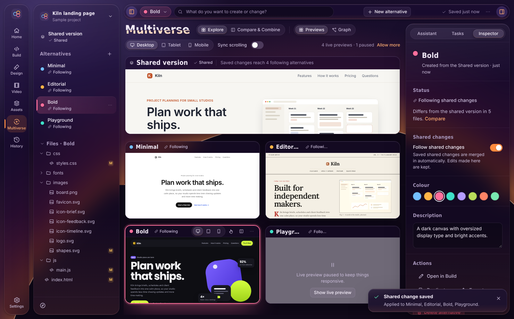

---

## Quick start (Windows)

Requirements: Windows 10 or 11, **Node.js 22.12+** (tested on Node 24 LTS) and npm. Video needs **FFmpeg**: put `ffmpeg` and `ffprobe` on your PATH (for example `winget install Gyan.FFmpeg`), or set `MV_FFMPEG` and `MV_FFPROBE` to their full paths. Everything else works without it, and the Video workspace says so if it is missing.

```bash
npm ci                 # Install the versions in package-lock.json
npm run dev            # Vite dev server + Electron with live reload
```

On first launch, choose how to start: **Start with AI** (connect a provider, or skip, then describe the project), **Create manually** (a website, app or video template, or the sample project with its multiverse tour) or **Open existing work** (a project folder, or media files for a new video).

| Command | What it does |
| --- | --- |
| `npm run dev` | Development: UI dev server, watched main/worker/preload builds, Electron restart on change |
| `npm test` | Engine, merge, storage, combine, export, security and parser tests (`node:test`) |
| `npm run typecheck` | Strict TypeScript for the Node side (`tsconfig.node.json`) and the UI (`tsconfig.web.json`) |
| `npm run build` | Type-check, build the UI (`dist/`) and the Electron bundles (`dist-electron/`) |
| `npm start` | Run the built app |
| `npm run package:win` | Build Windows installers into `release/`: NSIS (x64 + arm64) and a portable x64 `.exe` |
| `npm run package:dir` | Unpacked app folder for a quick local check |
| `npm run test:e2e` | Desktop end-to-end test with Playwright's Electron driver (`e2e/electron.spec.ts`) |
| `npm run test:e2e:harness` | The same journey in Chromium through the browser harness (no Electron needed) |
| `npm run harness` | Run the UI in a normal browser against the real engine (http://127.0.0.1:5199) |
| `npm run bench` | Performance measurements on this machine; writes `docs/BENCHMARKS.md` |
| `npm run bundle:ffmpeg -- <ffmpeg> <ffprobe>` | Copy FFmpeg into `resources/bin` so installers ship it (writes a licence note) |

Install the browser used by the test suite with `npx playwright install chromium`. The project uses **npm** throughout. Installers are unsigned; Windows SmartScreen will ask for confirmation the first time.

---

## The first minute

1. **Create sample project.** You get a landing page for a fictional product, *Kiln*, with three real alternatives: **Minimal**, **Editorial** and **Bold**. They differ in layout, typography, navigation, hero and footer.
2. **Tour step 1 — Make a shared change.** “Kiln” becomes “Kilnworks” in the Shared version. All three alternatives update and keep their own designs.
3. **Tour step 2 — Create a genuine conflict.** The Shared version changes the hero heading that Editorial had rewritten. Minimal and Bold update; Editorial shows *1 conflict*.
4. **Tour step 3 — Resolve it.** Both wordings appear side by side. Keep one, keep both, or write a combined heading.
5. **Tour step 4 — Combine.** Bold's footer goes into a new alternative based on Minimal. Before anything is applied you can review the CSS rules, design tokens, font, assets and JavaScript the footer depends on.
6. **Tour step 5 — Export** the result as a normal folder or ZIP.

Every tour step uses the same API as the rest of the interface; there are no demo-only shortcuts. You can also do each step by hand. See [Reproducing the demo manually](#reproducing-the-demo-manually).

---

## Concepts

| Term | Meaning |
| --- | --- |
| **Shared version** | The common base of the project. Edits stay a *draft* (kept on disk) until you **Save shared change**. |
| **Alternative** | An independent direction. It starts as an exact copy of its source and saves automatically. |
| **Shared change** | A saved edit to the Shared version. |
| **Follow shared changes** | Per alternative. When on, shared changes are merged in automatically and the alternative's own edits are kept. Pausing keeps the content as it is. Resuming reconciles everything you missed. |
| **Compare** | Live previews side by side (matched sizes, optional synced scrolling) plus a source diff of changed files. |
| **Combine** | Take whole files, individual changes, three-way merges or HTML sections from other versions. Review the result, then apply it as one step. |
| **Checkpoint** | A named snapshot of every version. One is created automatically before each combine, restore, undo and delete. |
| **History** | A timeline of changes and checkpoints with read-only previews. Restoring adds a new step, so later history is never lost. |
| **Export** | Writes the effective files of any alternative or checkpoint as an ordinary static site. |

Creating an alternative *from another alternative* records where it came from (the graph shows this). It does **not** link them: later edits to the source don't flow into the copy. Only shared changes flow automatically, and only into alternatives that follow them.

---

## Architecture

```
┌─────────────────────────── Electron main process ───────────────────────────┐
│ window · single-instance lock · native dialogs · settings                   │
│ app://bundle/  → UI files (strict CSP)                                      │
│ mvpreview://t<token>/ → project content for previews (per-token CSP)        │
│ ipcMain 'mv:invoke' → validates sender + zod-validates input ──┐            │
└────────────────────────────────────────────────────────────────┼────────────┘
                                                                 │ postMessage
┌──────────────── engine worker thread (worker_threads) ─────────▼────────────┐
│ StudioService (src/services) → ProjectEngine (src/engine) + web adapter     │
│ content-addressed store · revisions · diff3 merges · combine · export       │
└─────────────────────────────────────────────────────────────────────────────┘
┌──────────── renderer (sandboxed, contextIsolation, no Node) ────────────────┐
│ React + zustand UI · Monaco · preload exposes only invoke() + onEvent()     │
│   └─ <iframe sandbox="allow-scripts allow-forms" src="mvpreview://…">       │
└─────────────────────────────────────────────────────────────────────────────┘
```

| Layer | Where | Notes |
| --- | --- | --- |
| Desktop shell and filesystem access | `src/main`, `src/preload` | The only code that touches Electron. IPC is one allow-listed `invoke` channel with typed, validated inputs (`src/shared/ipc.ts`). |
| Project storage and revision engine | `src/engine` (`project.ts`, `store/*`) | Plain Node, no Electron. Fully testable on its own. |
| Shared-change propagation and merging | `src/engine/merge/*`, `ProjectEngine.saveShared` | Line-based **diff3** on top of jsdiff's Myers diff; tree-level merge handles add, delete, binary and modify/delete. |
| Combining | `src/engine/combine/combine.ts`, `src/adapters/web/sections.ts` | File, hunk and merge actions plus HTML sections; applied atomically with a checkpoint. |
| Preview generation | `src/preview/*` | Token registry, path rules, headers, CSP and an injected bridge script. Shared by Electron's protocol and the harness. |
| Project adapters | `src/adapters` | `ProjectAdapter` interface (validation, diagnostics, references, optional structural combining). `web` is the only adapter today. |
| User interface | `src/renderer` | Design tokens (`design/tokens.css`), components, shell, four workspaces. |

### Data model and storage

Projects live in the app-managed workspace at `%APPDATA%\Multiverse Studio\Workspace\Projects\<id>\`. **Importing copies the folder; the original is never modified.** The import report and *Project details* show both paths.

```
project.json        manifest: lines, checkpoints, operations, shared log (zod-validated on open)
project.json.bak    previous manifest, used for automatic recovery
objects/ab/cd…      content-addressed blobs and trees (SHA-256); identical content stored once
revisions/ab/…json  immutable revision records (tree, parents, kind, message, changed files)
```

- **Lines.** Each line (the Shared version or an alternative) points at a head revision. The Shared version also has an optional draft tree. Each alternative records the **shared revision it has incorporated**; this is the correct base for every later three-way merge, including after pausing and resuming.
- **Crash safety.** Blobs, trees and revisions are written first, through temporary files and atomic rename with retries for Windows file locks. The manifest is replaced last, after the previous one is copied to `.bak`. On reopening, the manifest is validated and every referenced revision, tree and blob is checked. Damaged metadata falls back to the backup automatically, or produces a recoverable error that lists the details.
- **Autosave.** Alternatives save every edit. Rapid edits are coalesced into one revision per five minutes, and nothing that a checkpoint, a lineage link or a merge base points at is ever folded in. Unreachable objects left behind by coalescing are removed when a project opens, but only if they are more than ten minutes old and not referenced by the backup manifest.

### Shared-change propagation

Saving the Shared version creates a revision and, **in the same atomic commit**, reconciles every following alternative:

```
merge(base = shared revision the alternative incorporated,
      ours = the alternative's current content,
      theirs = the new shared revision)
```

- Compatible changes are applied. Overlapping or directly adjacent edits are conflicts, never silent overwrites. Identical edits on both sides are not conflicts.
- If an alternative has conflicts, compatible files are applied and conflicted files keep the alternative's last coherent version, so the preview never shows conflict markers. Both sides are stored. Conflicted files are read-only until resolved; other files stay editable.
- Further shared changes **queue** behind an open conflict and are applied as soon as it's resolved.
- An edit typed against an older version of a file (for example, a shared change landed while you were typing) is three-way merged on save, or refused with your text kept in the editor.

### Combining

- **Files and text.** Per file you can keep the destination, take the source, **merge** against the *common revision* of destination and source (best common ancestor in the revision graph), or pick individual diff hunks. You can also edit the proposed result.
- **HTML sections.** These are elements with a unique `id`, or landmarks (`header`, `nav`, `main`, `section`, `article`, `aside`, `footer`) addressed by tag and position. A purpose-built locator keeps exact source offsets, so the section is spliced in without reformatting the rest of the page. Misnested markup is reported as *uncertain*, and you're pointed to file or text combining instead.
- **Analysis before applying.** You get the related CSS rules (including those inside `@media`), design tokens (`var(--…)`, optionally scoped to the section), `@font-face` and `@keyframes` dependencies, and local assets (copy or skip). Warnings cover duplicate IDs, selectors that may also restyle other parts of the destination, existing destination styles, global element styles that aren't copied, and scripts that refer to the section. The UI states that copying markup doesn't guarantee identical behaviour.
- **Every combine** builds a proposal you can preview live, creates a checkpoint, applies atomically, keeps the originals, can be undone, and ends with a summary.

### Preview security

- Project HTML and JavaScript are treated as untrusted. Previews are `sandbox="allow-scripts allow-forms"` iframes with an **opaque origin** (forms raise submit events for the app’s own handlers; the CSP’s `form-action 'none'` blocks any real submission), served from `mvpreview://<random token>/`. They can't reach Node, Electron, IPC, the preload bridge, the app's filesystem bridge, or other previews.
- Each HTML response carries a CSP that limits every fetch to that preview's own origin: no remote network, frames, workers, objects or form posts. The main process also cancels all `http(s)`/`ws(s)` requests, denies popups and permissions, and blocks preview navigation away from `mvpreview:`. External links in a preview show a notice instead of navigating.
- Paths are decoded and normalized with one set of rules (`src/shared/paths.ts`) that rejects traversal (including encoded forms), absolute and drive paths, UNC paths and reserved Windows device names.
- Import skips symlinks that point outside the project and tool folders like `.git` and `node_modules`. All of these are reported.
- Every IPC input is validated with zod in the main process, and again in the worker.

---

## Reproducing the demo manually

For the AI director demonstration with the Orbit app (14 steps, by hand or with the director), see `docs/DEMO.md`. The original multiverse demo:

1. Create the sample project, select **Shared version**, open **Build** (Ctrl+2) and replace `Kiln` with `Kilnworks` in `index.html`. Click **Save shared change**. The notification lists Minimal, Editorial and Bold; each keeps its own layout.
2. Still in the Shared version, change `Plan work that ships.` to `Built for growing teams.` and save. Editorial reports *1 conflict*; Minimal and Bold update.
3. Click **Review conflict** (or *Resolve* in the inspector), choose a wording or write a combined one, then **Finish and apply**.
4. Open **Multiverse** (Ctrl+6) → **Compare & Combine → Combine**. Choose **New alternative** starting from Minimal, take from Bold, and choose **Footer · Site footer** in *HTML sections* (or **Pick in preview**). Review the CSS, tokens and assets, **Add to combination**, **Review combination**, then **Apply combination**.
5. Select the new alternative and open **⋯ → Export…**. Choose Folder or ZIP and open `index.html` from the exported folder in any browser.

---

## AI: providers, models, keys and the coding agent (v0.2)

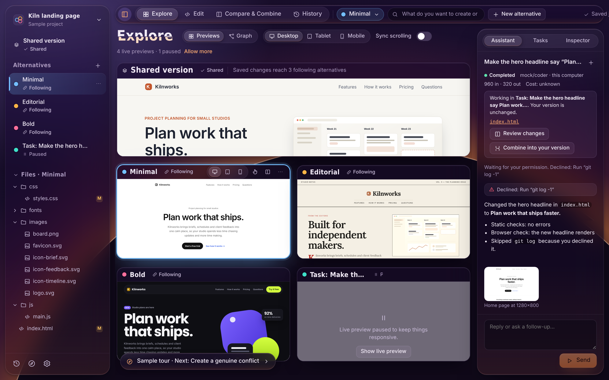

### Supported providers and protocols

Adapters are organised by wire protocol, not by brand. An API key alone does not identify a protocol. Custom endpoints choose a protocol explicitly, and the connection test confirms it.

| Provider | Protocol (adapter) | Discovery | Media endpoints |
| --- | --- | --- | --- |
| OpenAI | Responses API (`POST /responses`, SSE, `store: false`) or Chat Completions | `GET /models` (existence only) | Images (`POST /images/generations`, base64 results) and transcription (`POST /audio/transcriptions`, timed segments where the model supports them). The Sora video API was shut down in Sept 2026 and is not offered. |
| Anthropic | Messages API (`x-api-key`, `anthropic-version: 2023-06-01`) | `GET /models`, including its capability flags | — |
| Google Gemini | `models/{id}:streamGenerateContent?alt=sse` with `x-goog-api-key` | `GET /models` (`supportedGenerationMethods`) | Interactions API: images, voice-over (speech output) and video. Video runs as a background interaction that is polled, cancellable and followed again after a restart. |
| OpenRouter | OpenAI-compatible Chat Completions | `GET /models` (modalities, tool support, per-token prices) | — |
| Ollama (local) | Native `/api/chat` (NDJSON) or OpenAI-compatible | `/api/tags` and `/api/show` capabilities | — |
| LM Studio (local) | OpenAI-compatible Chat Completions | `GET /models` | — |
| Custom endpoint | OpenAI Chat, OpenAI Responses or Anthropic Messages | per protocol | OpenAI-compatible endpoints can turn on images and transcriptions (for example a local Whisper server). |

APIs with a different wire format need an adapter. Implement `ProviderAdapter` in `src/ai/types.ts` (list models and stream a request) and register it in `src/ai/adapters/index.ts`. Model identifiers are never hard-coded: they are discovered or entered by hand.

### Capabilities and routing

Each model records ten capabilities, each marked **verified** (a real request succeeded), **declared** (provider metadata or you), **unavailable**, or **unknown**:

- text, code, vision, tools, structured output;
- image generation, speech recognition, speech generation;
- video generation, video understanding.

**Settings → Models** assigns a model to each job: Assistant, Coding agent, Private text (local models only), Image generation, Transcription, Voice-over and Video generation.

- Assigning a model that is unavailable for a job is refused, and the refusal names a model that can do the job.
- **Verify** sends one tiny request; it may cost a fraction of a cent.
- Successful tasks verify what they exercised.

### Keys and data handling

- Keys live in the main process.
- In the desktop app, Electron `safeStorage` encrypts each key and stores it in `userData/ai/credentials.json`: DPAPI on Windows, Keychain on macOS, Secret Service on Linux. Linux `basic_text` counts as not secure.
- Without OS encryption, keys are kept for the session only and nothing is written. The UI says which applies.
- The renderer can set or clear a key but never read one back.
- The engine worker asks main for a key per request.
- Keys are redacted from task records, errors, logs and anything sent to a model.
- No key is ever written to projects, exports or child-process environments.
- The composer shows the provider before you send, says whether it runs on this computer, and lists exactly which files and selection will be sent. Only files you attach, and files the agent reads through tools, leave the computer.
- Media jobs show the same before sending: provider, model, each item uploaded with its size, and the cost (**Unknown** unless the provider publishes a price). Media is only uploaded for the job you start: a starting image for a video, or an audio extract for transcription (never the picture). Nothing is uploaded because it is in the library.
- A provider-hosted result is downloaded with your key only from the provider's own host; other download links get no key.

### Tasks, usage and budgets

- Tasks are persistent state machines: queued, running, paused, waiting for you, cancelling, completed, failed, interrupted or cancelled.
- Each task is saved in the project under `ai/tasks/`.
- Tasks that were running when the app stopped are marked **interrupted** on reopen and are never resubmitted automatically. **Retry** is a deliberate action.
- Token usage is shown when the provider reports it.
- Costs are labelled **estimates**. They are calculated only from provider-reported prices (OpenRouter, local servers) or prices you enter, and are otherwise shown as **Unknown**.
- Per-task limits: budget (enforced only when prices are known), rounds of actions and minutes.

### The coding agent

Modes:
- **Ask** explains things.
- **Plan** uses read-only tools and proposes a plan.
- **Build** creates a **task alternative** from the version you are on, so your version is never touched, and works there.
- **Autopilot** (when allowed for the project) works like Build without asking for routine steps.

**Typed tools.** Every argument is validated, and file tools check paths against the project:
- files: `list_files`, `read_file`, `search_project`, `edit_file` (exact replacements, checked against the revision the agent read), `write_file`, `move_file`, `delete_file`;
- commands: `run_command`, `run_tests`, `start_dev_server`, `read_process_output`, `stop_process`;
- pages: `inspect_preview`, `capture_screenshot`, `run_browser_check`;
- versions: `create_checkpoint`, `compare_revisions`.

**Permissions.** Per task, you allow routine actions: editing its task alternative, running the project's scripts, installing dependencies (off by default) and running the preview.
- Anything else pauses the task and asks: **Allow once** or **Decline**.
- The agent has no tools for publishing, purchases, credentials or files outside the project.

**Studio control (director).** In Plan, Build and Autopilot the agent also has:
- `get_studio_state`: universes (versions) and the one the task works in, the objects you referenced, the playhead, sequences with track and clip ids, assets, dependencies, running processes, unresolved conflicts, assigned models with their capabilities, and the budget;
- `list_studio_commands`: every registered command (video.*, design.*, code.*, assets.*) with the JSON Schema of its arguments;
- `run_studio_command` (Build and Autopilot): runs one of them in the task's universe through the same command layer as the buttons — same validation, expected-revision check and undo. A title the AI adds is the same editable title you would get by hand.

**References.** Whatever you have selected — clips on the timeline, the sequence, a page element in Design, an asset, the open file — appears under the prompt as a chip. Remove any you don't mean. They are sent as ids and names (with the playhead in Video), so “shorten these clips” or “change this heading” is unambiguous.

**One command system.** Buttons, menus, shortcuts and drag and drop reach the same commands the director uses. File edits (`design.*`, `video.*`, `code.*`, `objects.*`, `assets.place`) are undoable transforms; project-level actions are commands too — `project.createUniverse`, `project.duplicateUniverse`, `project.deleteUniverse`, `project.createCheckpoint`, `universe.saveShared`, `universe.compare`, `universe.combine`, `render.start`, `assets.import`, `code.runTests` — each with a project, universe and resource id, an optional expected revision (refused, with nothing changed, if the version moved on), validated arguments, the actor (you or an AI task), a result and undo or checkpoint information. Every change is appended to the project's activity log, shown in **History → Activity** with *You* / *AI task* badges and an Undo where one exists. `code.applyPatch` applies a unified diff as one undoable step and refuses hunks whose context no longer matches.

**What the director may do on its own.** In Build and Autopilot, routine project actions run without asking (create universes and checkpoints, combine into its own universe or a new one, render into the cache, run tests when allowed). Saving the Shared version, deleting a universe it did not create, combining into another universe, writing a video outside the project and importing files from this computer all stop and ask. Each Build or Autopilot task starts with a checkpoint of every universe; the task panel offers *Restore from before the task…*.

**Roles and models without tool calling.** Settings → Models has a **Director** role (runs Plan, Build and Autopilot; falls back to the Coding agent's model) and **Visual inspection** (a vision model the director asks about screenshots with `look_at_page`; the screenshot is saved in the task so you see what was sent, and its usage counts toward the task). A model marked as having no tool calling but with structured output directs through a strict protocol: one fenced `json` command block per complete reply, parsed only after the reply ends, validated like any tool call; malformed or cut-off commands are never run and are reported back, two in a row stop the task, and a model with neither capability is refused with that reason.

**Autopilot.** Turn on *Autopilot for this project* in the Assistant to offer the Autopilot mode. It works in its own task alternative like Build, with every routine permission (edit, scripts, installs, preview checks) and the same budget, round and time limits; anything else still asks, and it has no tools for publishing, purchases, credentials or files outside the project. The setting is stored in the project.

**Review.** The panel lists the changed files and offers two actions:
- **Review changes**, which compares your version with the task alternative;
- **Combine into your version**, which uses the existing combine flow, with conflicts shown and both versions kept.

### Token saver

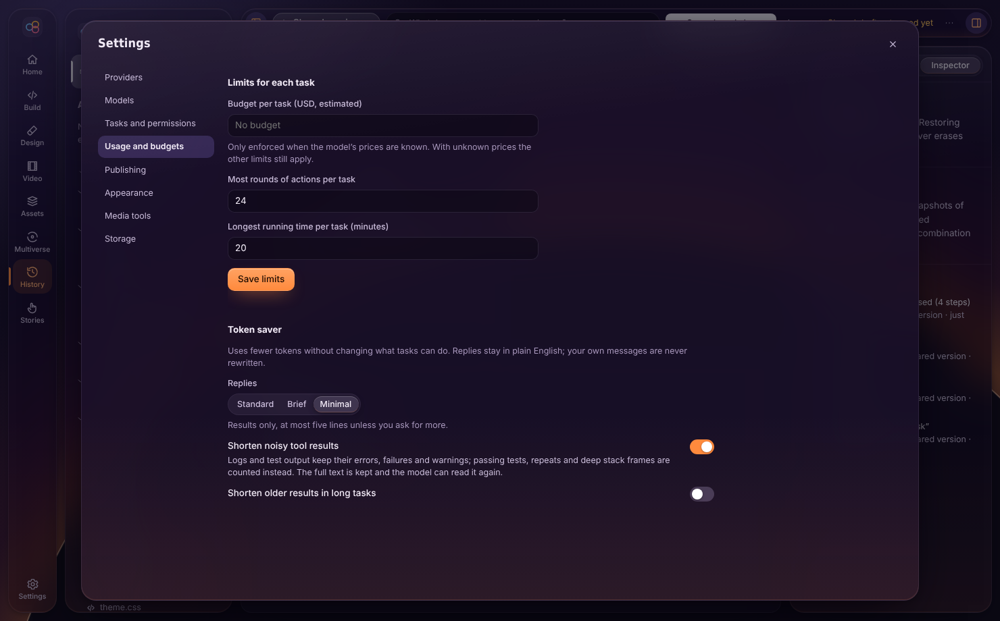

Settings → **Usage and budgets → Token saver** keeps tasks’ token use down, in the spirit of the [caveman](https://github.com/JuliusBrussee/caveman) project but in plain English. Everything is on by default and each part can be turned off.

- **Replies** — *Standard*, *Brief* (default) or *Minimal*. Brief adds rules to lead with the answer and skip preambles, restated requests, filler and closing recaps, with at most one short sentence between tool calls. Code, commands, paths, ids, numbers and error text stay exact, and risks, irreversible actions and failures are still explained in full. Minimal also limits final answers to five lines. Ask and Plan answers get a lower output limit (4,096 or 2,048 tokens); Build and Autopilot keep 8,192 so file contents fit in tool calls. Your own messages are never rewritten.
- **Shorter tool results** — command, test and log output loses colour codes, progress redraws, repeated lines, passing tests (counted instead), npm deprecation notices and stack frames inside Node or `node_modules` (counted after the project’s own frames). Every error, failure and warning line is kept with one line around it, plus the start and the end. JSON loses its indentation. File reads, searches and edit results are never shortened. The full text is saved under `<project>/ai/outputs/`, and the model can read it again with `read_full_output` (by line range, or the lines containing a text).
- **Shorter history in long tasks** — once the full tool results since the last batch pass about 40,000 characters, older results are replaced by a short note with their first line and the ref to read them again. The latest two rounds always stay in full. This happens in batches, not on every request: Anthropic’s and OpenAI’s caching documentation both say that rewriting earlier messages stops the cache from being reused.
- **Prompt caching** — Anthropic: cache breakpoints on the last tool, the instructions and the latest message (three of the four allowed). OpenAI Responses API: a stable `prompt_cache_key` per task (OpenAI also caches on its own). Only the official Anthropic and OpenAI connections get these fields; custom endpoints get none. Cached input tokens are read from every provider that reports them (Anthropic, OpenAI, OpenRouter, Gemini) and shown with each task. Anthropic counts cached tokens apart from `input_tokens`, so the app adds them back in and the totals are complete.
- **Leaner requests** — the task context (project, references, playhead) moved from the instructions into the first message, so the instructions are the same for every task in a mode and can be cached. The instructions say the same things in fewer words: Build went from 2,228 to 1,744 characters. Tool descriptions went from 7,313 to 6,725 characters. `list_studio_commands` returns one TypeScript-like signature per command (every argument, bound, pattern and choice kept) instead of JSON Schema: 58 commands take 25,859 characters instead of 129,359. `get_studio_state` is sent as compact JSON.
- **What it saved** — each task shows cached input tokens and *About N tokens saved*. Saved tokens are an estimate (characters ÷ 4) of what compaction kept out of every request. Hover over a task’s token count to see where its last request went: instructions, tool definitions, conversation and tool results. Usage and budgets totals these for the project.

Measured here: a real `node --test` run of the Orbit tests with 43 passing tests and one failure went from 5,084 to 645 characters, keeping the failure’s full assertion message and its location. These are character counts, not provider token counts, and no live provider was called to measure cache hits.

### Use it from ChatGPT, Claude and other AI apps

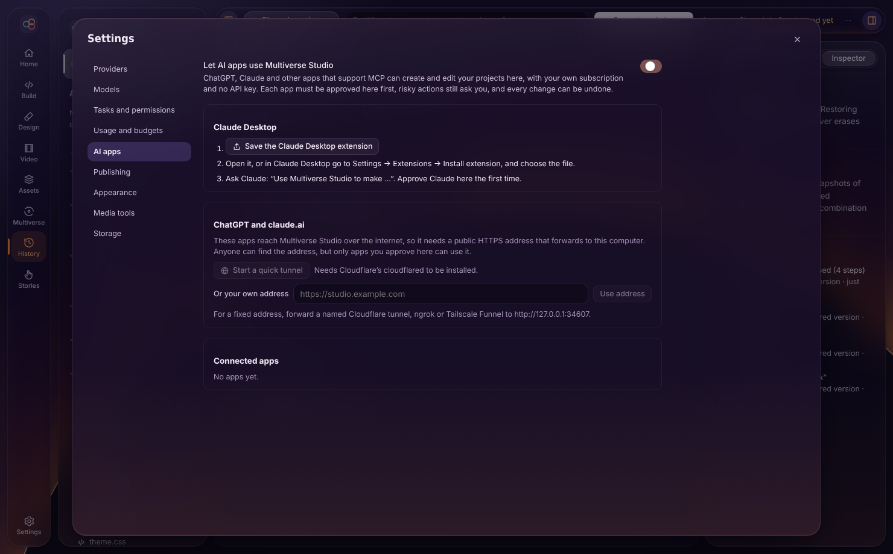

Settings → **AI apps** lets an AI app you already pay for drive the studio, with no API key in the studio. Say *“Use Multiverse Studio to make a landing page for my bakery”* and the app opens a project here and works with the same commands, undo and approvals as the built-in AI. It is an [MCP](https://modelcontextprotocol.io) server inside the app, so no screen control is involved.

- **Claude Desktop (and other local MCP apps):** *Save the Claude Desktop extension* writes `Multiverse Studio.mcpb` to Downloads. Open it to install, or paste the shown configuration. A small relay (`resources/connector/bridge.mjs`, no dependencies) passes messages to the studio on `127.0.0.1` using a token kept in `~/.multiverse-studio/` (owner-only permissions), and starts the studio if it isn't running. Each app is approved once, by name, in the studio.
- **ChatGPT and claude.ai (remote):** these reach a connector over HTTPS. *Start a quick tunnel* uses Cloudflare's `cloudflared` quick tunnel if it is installed, or you can enter your own HTTPS address that forwards to the studio's port. Add the shown address as a custom connector (ChatGPT: Developer mode on plans that offer it). Sign-in is OAuth 2.1 with PKCE, dynamic client registration, audience-bound tokens and rotating refresh tokens. You approve each sign-in in the studio, and *Disconnect* revokes an app. Quick-tunnel addresses change each time the tunnel starts, so the app has to be connected again with the new address.
- **What apps can do:** list and create projects, read the studio state and files, run any studio command (code edits, Design, Video, stories, universes), look at a page as an image, and undo. Every change is logged under the app's name (History shows *ChatGPT* or *Claude*), the first change in a session makes a checkpoint, and anything that asks for approval for the built-in AI (deleting a universe, for example) asks you here. Running the project's tests also asks every time, because it runs the project's own scripts on this computer. Pausing an app in the activity bar refuses its changes until you resume.
- **Protocol:** the current MCP specification (`2026-07-28`, stateless, with mirrored headers checked) and the earlier `initialize` handshake (2025-03-26 to 2025-11-25). Requests are accepted only on this computer's address or the tunnel's host, with origin checks.

Not tested against the real ChatGPT or Claude apps here: the protocol, OAuth flow, extension file and relay are tested with scripted clients (`tests/connector.test.ts`, and the harness journey drives the local endpoint).

### Live AI activity

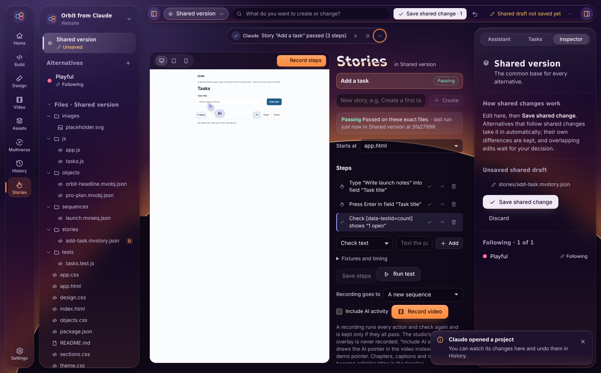

When the built-in AI or a connected app works, the studio shows what it is doing, from the engine's own events:

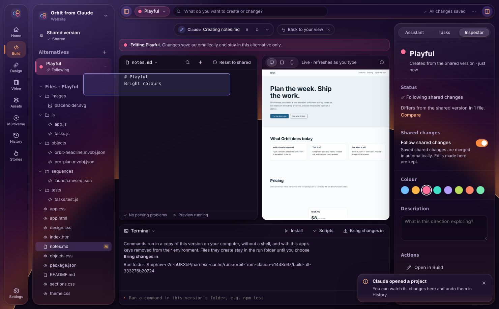

- **The activity bar** appears in a row reserved under the toolbar (the workspace moves down once, not on every update). It names who is working and what they are doing (*Claude · Creating notes.md · Playful*), has Pause/Resume and Stop, and expands to the current step, changed resources, checks, errors and other tasks. With several tasks, a count opens a chooser. When the work is in another universe or workspace, *View activity* goes there; *Back to your view* returns.
- **One highlight at a time** outlines the real target: changed lines in Build (or the file in the tree), the element in the Design canvas (by its id), a clip or track in Video, an asset or object card, a universe in the sidebar or graph. It fades out after a moment and never covers the workspace with boxes. Nothing is drawn on a universe the AI isn't changing.
- **The AI pointer** (periwinkle, labelled *AI*) appears only for real browser interactions: the clicks, typing and key presses of a story run, shown on the same element in the Stories preview and labelled as happening in the test browser. Checks get a dashed outline instead of a pointer. A failed step stays marked.
- **You come first.** The overlay never takes clicks, focus or selection, and typing or clicking clears it. If you edit the file, page or sequence the AI just changed, the task pauses (*Paused while you edit*) and resumes 2.5 seconds after you stop. The revision checks still refuse any AI write based on an older version, so your typing is never overwritten.
- **Honest status:** phases come from the event (planning, reading, editing, running, testing, recording, waiting, paused). The built-in AI's pause takes effect after the current step and says so first. Progress is shown only when it is measured (story steps finished out of steps). A connected app has no “finished” signal, so after 45 seconds without requests it shows *Waiting for Claude*.
- **Settings → Appearance:** AI activity *Off* (the bar only), *Minimal* (default) or *Detailed* (each highlight is labelled, such as *Adjusting style on the homepage · color*), *Follow AI* (opens the resource being changed once you haven't touched anything for a moment), and the pointer label. Reduced motion shows everything in place without movement; reduced transparency makes the bar solid.
- **Never recorded:** the overlay exists only in the studio window, so exports, story recordings and validation screenshots never contain it. *Include AI activity* on a story recording draws the AI pointer in the video instead of the plain demo pointer.

### Execution isolation

**Trusted local runner.** Commands run on this computer:
- as you;
- in a run directory under the app cache that holds a copy of the task alternative;
- through argument arrays (never a shell);
- with an allow-listed environment that drops anything resembling a credential.

The UI states plainly that **this is not a sandbox**. Some files never come back into the project when changes are synced: `node_modules`, build output, caches and `.env` files. Cancelling a task, closing a project or quitting the app kills each child process tree.

**Browser checks.**
- Desktop app: a hidden, sandboxed window in its own session partition, with no preload and network access limited to `127.0.0.1` and previews.
- Harness: Playwright.

**Not implemented: a container (isolated) runner.**

---

## Workspaces (v0.2)

The rail on the left switches workspaces (Ctrl+1–8):

| Workspace | What it is for |
| --- | --- |
| **Home** | The open project, recent AI tasks, templates and other projects |
| **Build** | Code editor with a live preview, plus a terminal panel (Ctrl+J) |
| **Design** | Visual editing of HTML pages |
| **Video** | Timeline editing and export |
| **Assets** | The project's media library, AI generation, brand settings and site images |
| **Multiverse** | *Explore* (alternatives side by side, the graph, and *Updates*) and *Compare & Combine* |
| **History** | Checkpoints, restore and undo |
| **Stories** | Product flows recorded once and reused as browser tests, walkthroughs and video footage |

### Templates

| Template | Stack | Notes |
| --- | --- | --- |
| Landing page, Portfolio, Small business | HTML and CSS | Sections and theme tokens that Design understands; preview right away |
| Dashboard | React, TypeScript, Vite | Demo data is labelled as such; loading, empty and error states; tests for the data helpers |
| Database app | React + Vite client, Node API (`node:http`), SQLite (`node:sqlite`) | SQL migrations, input validation, demo rows flagged `is_demo` with a *Remove demo data* button, `.env.example`, API tests, README |
| Orbit demo app | HTML, CSS and JavaScript; `node:test` | A fictional task app (tasks kept in the browser only, and it says so), its marketing site, tests with no install, a pricing card and headline shared with a 30-second launch sequence. Used by `docs/DEMO.md` |
| Launch video | Video sequence | 1920×1080, 30 fps: an editable title card, lower third and end card with space for your footage; opens in Video |

App templates need `npm install` (Build → Install), which downloads packages from the npm registry.

### Design

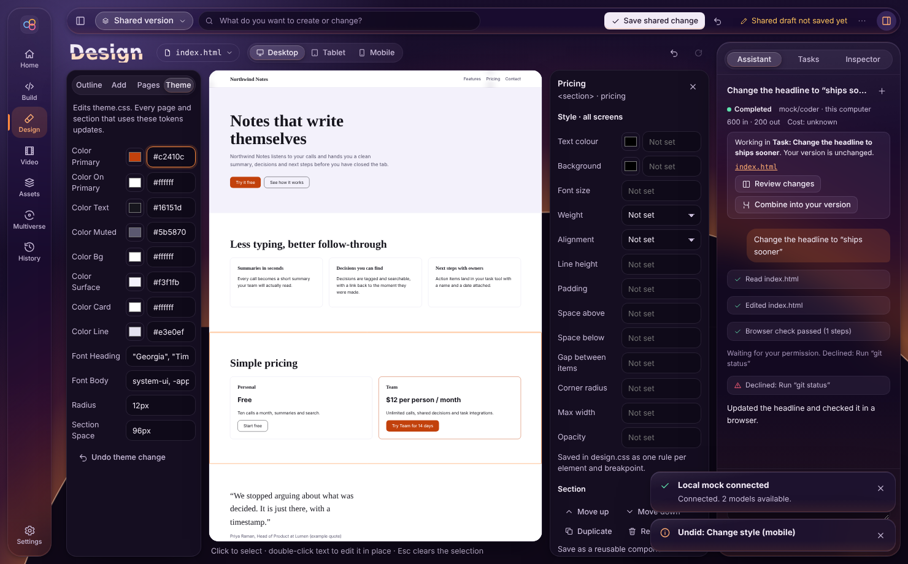

Click an element on the canvas to select it; double-click text to edit it in place. The side panels edit:
- text, links, images and alt text;
- styles per breakpoint (desktop, tablet ≤ 900 px, phone ≤ 600 px);
- sections from a library (insert, move, duplicate, remove);
- pages, reusable components (save, insert, update other uses) and theme tokens.

Every change is a command that rewrites the HTML or `design.css` exactly, and nothing else in the file. The editor refuses a change if the file changed underneath it since you loaded it. Undo and redo survive restarts. Pages that are drawn by a framework (React, Vue…) are recognised and sent to Build instead.

### Build: terminal and dev server

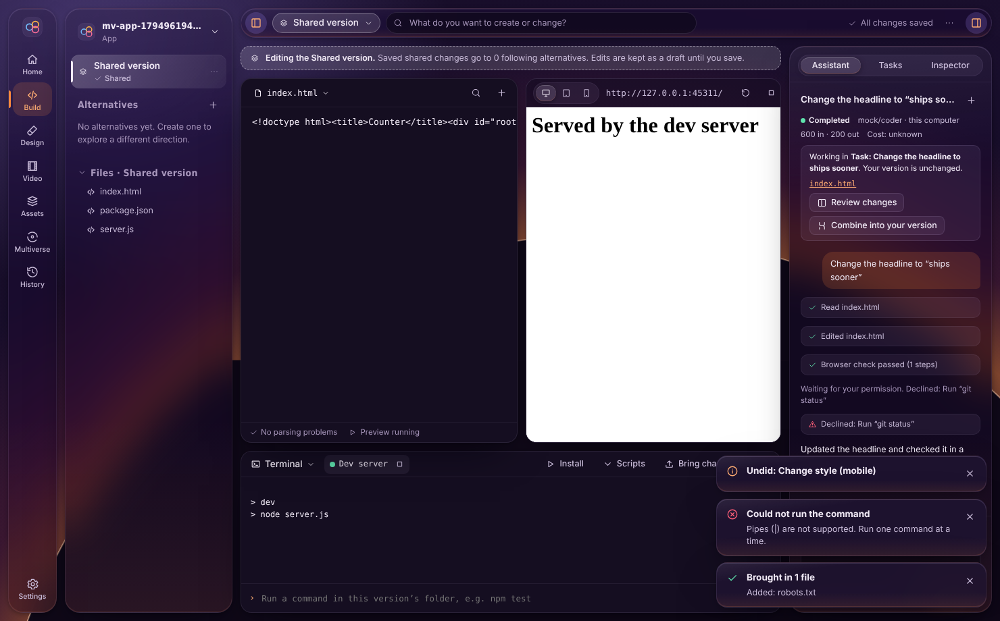

Commands run in a *run folder*: a copy of the selected version on your computer.
- **No shell.** Pipes, redirection, chaining, substitution and variables are refused with an explanation.
- **No app keys.** This app's own keys are removed from the environment.
- **Nothing comes back by itself.** Files that commands create stay in the run folder until you choose **Bring changes in**. Dependencies, build output, logs, local database files and `.env` are never brought in.

**Start dev server** picks a free port. Vite projects get `--port --strictPort --host 127.0.0.1`; others get `PORT` and `HOST`. The running app shows in the preview. In the desktop app, only the ports of dev servers you started can load in a frame. This is a trusted local runner, **not a sandbox**.

### Video

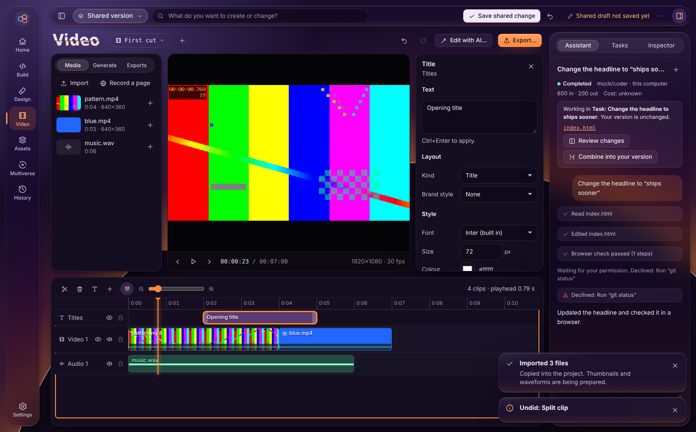

- **Media.** Imported files are **copied** into the project's media store (content-addressed, shared by every version); originals are not changed. Thumbnails, filmstrips, waveforms and preview copies (for codecs Chromium can't play, such as HEVC) are made in the background. Missing files are flagged and can be relinked.
- **Sequences** are files in the version (`sequences/*.mvseq.json`), so alternatives can try different cuts of the same footage. Time is stored in integer ticks, 240,000 per second.
- **Editing.**
  - Tracks: video, audio and titles, with mute, hide and lock.
  - Clips: drag, trim, split (S), delete (Shift+Delete closes the gap), snapping, zoom.
  - Clip settings: volume, speed 0.25–4×, fades, crossfade or dip-to-black transitions, position, scale, rotation, opacity and crop.
  - Titles and motion graphics: plain titles, title cards, lower thirds (with a second line) and end cards. They use Inter or a font from Assets, can follow a brand text style, and are editable by hand or by AI.
  - Every edit can be undone.
- **Export.**
  - **Formats:** MP4 (H.264/AAC) or WebM (VP9/Opus).
  - **Options:** the sequence's own size or a landscape, portrait or square preset; resolution, frame rate and quality; and a five-second test range.
  - **Behaviour:** one export runs at a time, with progress and cancel. An export only shows *Done* after the file is read back with ffprobe and its codecs, size and duration match.
  - **After a quit:** an export cut short shows as *Interrupted* and is not restarted on its own.
- **The viewer is a preview.** Transitions show as fades into the incoming clip, and volume above 100% plays at 100%. The export renders exactly what the timeline says.

### AI media and AI timeline edits (milestone 5)

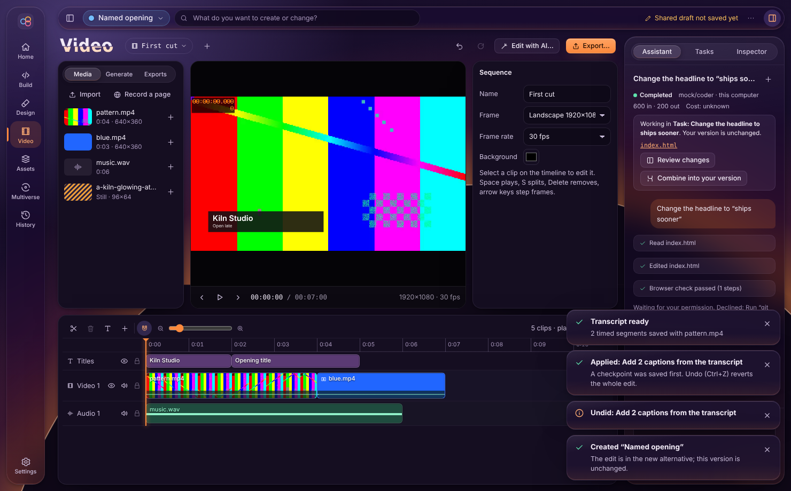

- **Generate** (Assets → Generate, or the Video bin): images, video clips and voice-overs from the models assigned in Settings → Models. Missing configuration is explained before anything is sent. **Review…** shows what will be sent and the cost; asking for several images states that each is billed.
- **Jobs** are saved in the project (`ai/media-jobs.json`) and move through queued, sending, working, saving, stopping, done, failed, stopped, interrupted and *check usage*. The provider's job or request id is kept.
  - **After a restart**, a video job with a provider id is checked again, not resent. A request that never left the computer is *interrupted* and safe to retry. A paid request that was in flight becomes *check usage*. It is never resent automatically, and resending needs you to confirm you checked your provider.
  - **Cancelling** says what it does: *Cancel at provider* for jobs the provider can stop, *Stop waiting* for requests that can't be cancelled (the provider may still finish and charge).
  - **Retries** are never automatic.
- **Results** land in the asset library tagged `generated` (or `voice-over`). Each records its provenance: provider, model, prompt, settings, time and request id. Use them on the timeline, copy them into a website version, or apply an AI edit as a new alternative.
- **Transcription** (clip inspector or Assets) sends a small mono audio extract and saves timed segments with the media.
- **Edit with AI** (Video):
  - Quick edits run on this computer with FFmpeg and no model: remove long pauses (silence detection), captions from a transcript, lower music during speech (transcript timings or detected speech), trim to a length, and a portrait copy reframed to fill 9:16.
  - Free-form requests ("put the product name over the opening shot") go to the coding-agent model with a text description of the timeline (clip names, times, titles, transcript text) and no media files. The model calls validated timeline tools; each call is checked on a copy of the timeline, and errors go back to the model.
  - *Propose two different versions* sends two requests (stated before sending) and each result can become its own alternative.
  - Every edit is a **proposal** with a summary, steps, warnings, before/after length and what was sent. Applying saves a checkpoint and runs **one** `video.batch` command, so a single undo reverts the whole edit. The result is ordinary clips and titles. Apply in place, or as a new alternative.
- **Record a page** (Website → Video): records any page of any version, or the running dev server, in an isolated browser (no bridge, no keys), as it loads or following steps: wait, scroll, click, type, hover. The recording is a normal video asset.
- **Fonts** (TTF, OTF, WOFF, WOFF2) are library assets. They can be used by titles (exports use TTF, OTF and WOFF; WOFF2 previews but exports with Inter) and by brand settings.

### Brand, shared media and updates

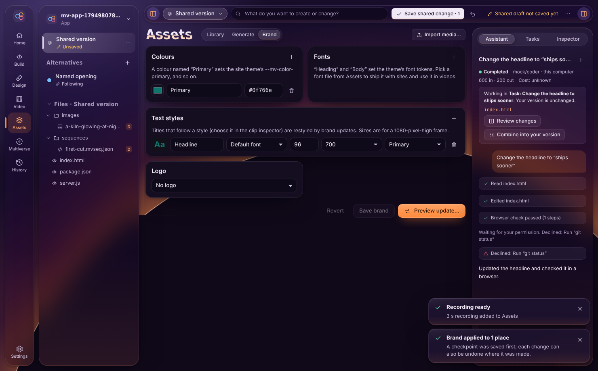

- **Brand** (Assets → Brand): colours, fonts, text styles and a logo, saved with the project. A colour named "Primary" drives a site's `--mv-color-primary` token; fonts named "Heading" and "Body" drive the font tokens. Library fonts are copied into the site with an `@font-face` block. Titles that follow a brand text style take its colour, font, weight and size.
  - **Preview update** lists, per version, the token changes and titles that would change. Only ticked items are applied, after a checkpoint; each site's update is one undoable step.
- **Shared media:** *Copy into version* places a library file into a version as an undoable command, and the copy is tracked (also in alternatives created later). When the library file changes (relinked to new content), copies are flagged as outdated and can be updated one by one or all together. A copy you edit or replace is yours and is no longer tracked.
- **Usage** in Assets shows every sequence, file copy and brand setting that uses an asset, across versions. Assets also has tags, search (names, tags and prompts), filters for generated media and recordings, and drag-and-drop import (the desktop app asks before importing dropped files).
- **Multiverse → Explore → Updates** lists everything a version uses that has moved on: npm packages that differ from Shared's `package.json` (match one or all, keeping the file's formatting), outdated media copies, and exported videos whose sequence or media changed since (*Export again*).

### Timelines across versions (milestone 6)

- **Merging.** Sequence files merge by clips and tracks, matched by id, never as lines of JSON. Changes to different aspects of a clip merge (one version trims it, another lowers its volume). Clip timing (track, start, in, out, length, speed) is one unit, so two different trims are one decision, never a clip with one side's in point and the other's out point.
  - Conflicts are per item: a clip both sides changed, a clip deleted on one side and changed on the other, a track deleted but changed, clips placed so they overlap, and sequence settings.
  - You choose *Keep*, *Use Shared*, or for clips *Keep both* (the incoming clip goes on a new track at the same time). Undecided items keep the alternative's side, so the timeline is always valid. Decisions can reveal new ones; the list updates.
- **Starting from an unsaved draft.** An alternative made from Shared's unsaved draft (for example by applying an AI edit as a new alternative) merges later shared changes against that draft, so no artificial conflicts appear.
- **Combining.** For timelines you can merge the two versions (with the same decisions) or pick whole tracks and single clips. Picked clips keep their times; one that would overlap the destination's clips goes on a new track. Picking lines of a timeline is refused.
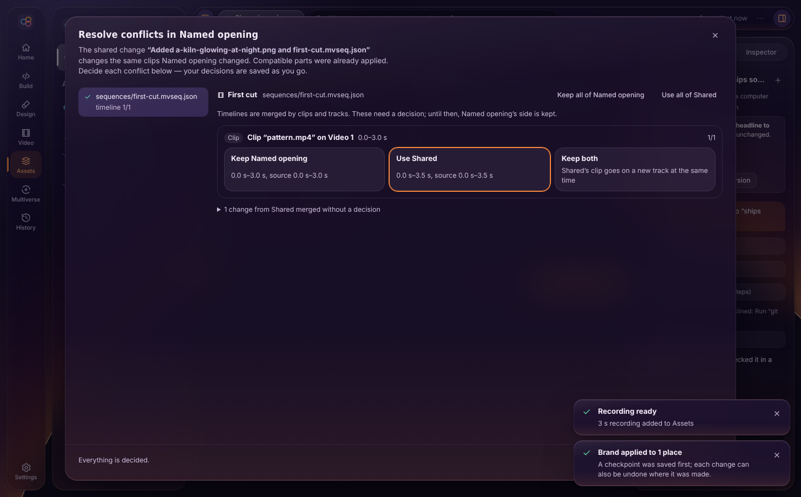

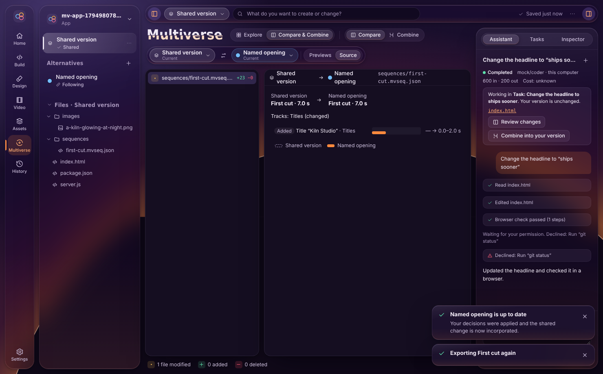

- **Comparing.** Compare → Source shows a timeline diff for sequence files: clips added, removed, moved or trimmed, on a common time scale. The combine review has a *Timeline* view of the proposed result. Websites keep live previews, and code keeps text diffs.
- **Outdated exports.** Each export records the sequence content and media it used. The Exports list and *Updates* say when the sequence was edited, its media changed, or it was deleted, and offer *Export again*.

### Living objects (director D3)

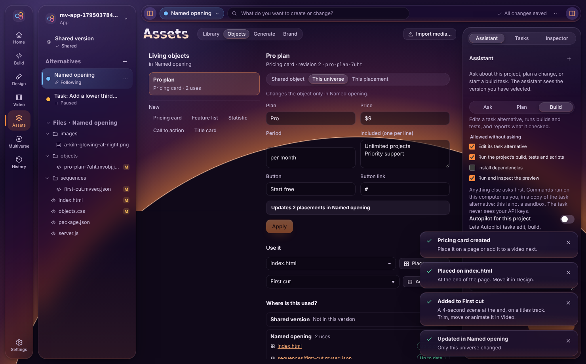

**Assets → Objects** holds content you create once and use in several places. The starter library: **pricing card**, **feature list**, **statistic**, **call to action** and **title card**. An object is a file in the universe (`objects/<id>.mvobj.json`: id, type, revision, properties, assets, targets, dependencies, per-target overrides), so universes keep their own copies and History, Compare and Combine treat it like any file.

- **Place on a page:** a themed section (`objects.css`, using the site's `--mv-*` tokens) marked with the object, instance and the revision it shows. Design shows it with an *Object* badge and a link to the object.
- **Add to a video:** an editable title scene (text, second line and layout from the object; timing, style, fades and transitions are the scene's own), drawn by the same title pipeline in the viewer and the export.
- **Three editing scopes:** *Shared object* (edits the Shared version's copy; following universes get it when you save Shared), *This universe*, and *This placement* (overrides for one use; empty fields fall back to the object). Before applying, the editor says how many placements the edit updates, how many edited by hand will be kept, and how many universes follow.
- **Where is this used?** Every universe, every placement, and whether it is up to date, needs an update or was edited by hand, with *Update uses* per universe.
- **Merging:** object files merge by property — a change from Shared flows in, and a value the universe changed itself is kept. Placements are derived: while merging, untouched placements are reduced to their object reference and rendered again from the merged object, so a shared rename and a universe's own price never collide inside the page. Placements edited by hand keep their text and merge like any other text.
- Commands: `objects.create`, `objects.update` (optionally updating placements in the same step), `objects.place`, `objects.addScene`, `objects.setInstance`, `objects.sync`, `objects.detach` — the director uses the same ones, and `get_studio_state` lists objects and their placements.
- **Not covered:** arbitrary components are not turned into video scenes; the video target is a title scene, not a picture of the web card; changing an object's linked asset images is not yet rendered.

### Stories (director D4)

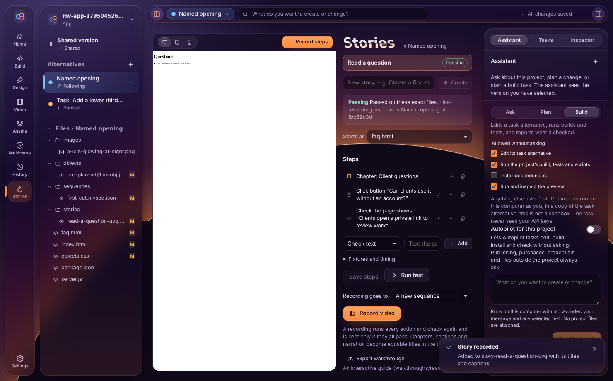

**Stories** (Ctrl+8) turns one product flow into a test, a walkthrough and footage. A story is a file in the universe (`stories/<id>.mvstory.json`): a start page, a viewport, fixture data, timing and steps.

- **Steps:** open a page, click, fill, press a key, wait, check (text, count, checked, value, absent), plus presentation steps (chapter, caption, narration, hold) that are never part of the test. Targets use test ids, `data-mv-id`, roles with names, labels, placeholders or text before CSS.
- **Recording:** *Record steps* captures clicks, typing and Enter in the live preview as steps with those locators. Add checks and presentation steps by hand.
- **Running:** each run uses a fresh browser with empty storage and records the exact files it depended on. A passing run says *Passed on these exact files*. When a dependency changes the story becomes *Needs a new run* (or *May need a new run* when the analysis can't be sure, for example with dynamic imports or an app dev server). A failing run names the step and keeps the last passing run.
- **Recording video:** every action and check runs again, and the clip is kept only if all pass — nothing is recorded for a broken flow. The clip enters Assets with its story, run, universe and revision, and can go into a timeline where chapters, captions and narration become editable title clips.
- **Walkthrough:** *Export walkthrough* writes `walkthroughs/<id>.html`, an interactive guide that performs each step in the real app when it is served from the same site (for example once published).
- Fixture data replaces `{{name}}`; use made-up data, never real customers or credentials.
- Commands: `stories.create`, `stories.update`, `stories.addToSequence`, `stories.exportWalkthrough`, and the operations `story.run`, `story.record`, `story.addToTimeline` — the director uses the same ones. Story runs cut off by closing the app are listed under Recovery and never count as passing.

### Outcomes, dependency-aware combining and releases (director D5)

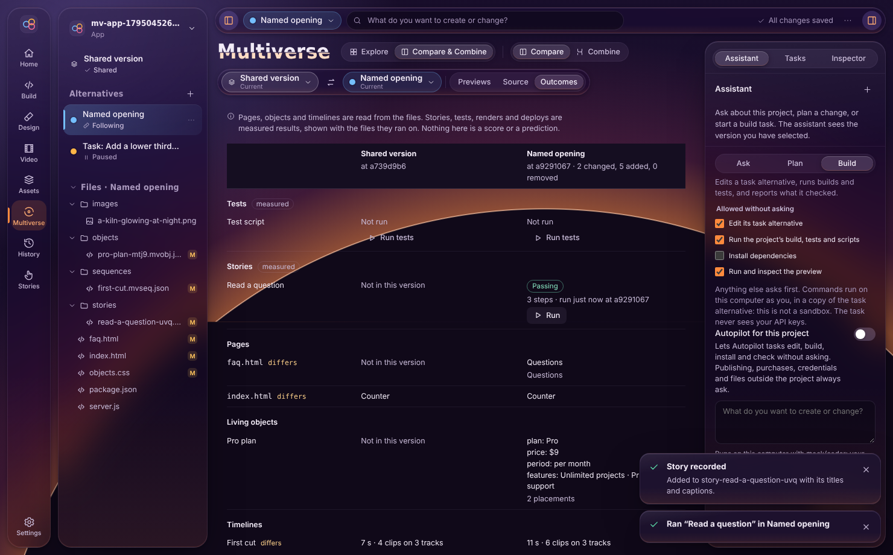

- **Outcomes** (Multiverse → Compare → *Outcomes*) compares two versions by what they produce: pages (title and heading, and whether they differ), living objects (which properties differ, how many placements), stories (the status of their latest run against these files), timelines (length, clips, tracks), renders (exports and whether they are outdated), deploys, and test runs (*Run tests* records the exit code and the exact code files). Measured results are labelled and say what they ran on. There are no scores, rankings or predictions.
- **Combining checks dependencies:** the review warns when picked parts rely on something the result lacks — a living object a page or scene uses, the object stylesheet, a file holding a test id or `data-mv-id` that a story step looks for, a page a story opens — with an *Include* button that takes it from the version that has it. It also lists the stories the combination makes worth running again. Object files merge by property and story files merge by step (different steps edited in two universes combine; the same step edited twice asks you to choose). A checkpoint is still created first.
- **Release destinations:** every website target and every exported video is its own destination with its own state, the version and exact revision it came from (and whether unsaved changes were included), and whether it still matches. A deploy sends exactly the reviewed files: a saved revision is read from history, and unsaved changes are checked by hash before upload (if they changed, nothing is sent). The app never presents several destinations as released together.

### The Orbit demonstration (director D6)

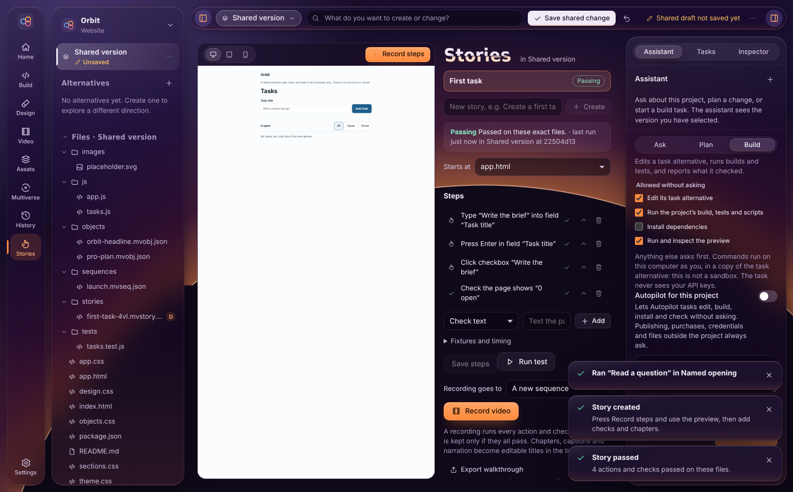

The **Orbit demo app** template and `docs/DEMO.md` walk through the 14 demonstration steps, by hand without a provider or with the director. `tests/orbit.test.ts` runs all 14 by hand through the same commands as the buttons (real Chromium and FFmpeg), including a restart.

### Publishing, storage and recovery (milestone 7)

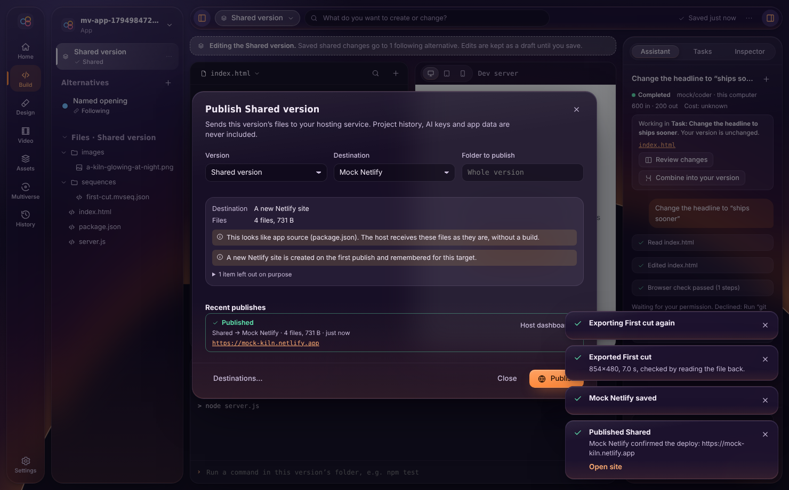

**Publishing** (Toolbar ⋯, the Inspector or a preview card → **Publish…**) sends one version's files to a hosting service through an explicit adapter:

| Host | How | Status reported | Cancel |
| --- | --- | --- | --- |
| Netlify | `POST /sites` (only when the destination has no site yet), then `POST /sites/{id}/deploys` with a ZIP body; `GET /deploys/{id}` until `ready` or `error` | the deploy's `ssl_url` / `deploy_ssl_url` | Netlify's ZIP deploys have no cancel: **Stop waiting** stops checking, and the UI says the host may still publish |
| Vercel | `POST /v2/files` per file (SHA-1 digest), then `POST /v13/deployments` (static, `framework: null`, optional `target: production`, optional `teamId`); `GET /v13/deployments/{id}` until `READY`, `ERROR` or `CANCELED` | the assigned alias, otherwise the deployment URL | `PATCH /v12/deployments/{id}/cancel` |

- **Destinations** live in Settings → Publishing. Each has its own access token, stored like AI keys (OS encryption, or this session only) under a separate id; tokens never reach the renderer, projects, exports, generated apps, logs or models.
- **The plan comes first:** destination, file count and size, files left out on purpose (`.env*`, `node_modules`, `.git`, video sequences, app metadata), warnings, and — if publishing is not possible yet — the exact requirement: a missing token, no `index.html` (with build folders it found, such as `dist/`), or a size limit. App source is published as files; there is no remote build.
- **You start every publish.** A publish is a persistent job: queued → packaging → uploading → processing → completed, failed, cancelled, interrupted or *result unknown*. It is **Published** only after the host reports the deploy live, and the URL shown is the one the host returned.
- **After a restart:** a job with a deploy id is checked again; one that was sending a create request becomes *result unknown* and is only sent again after you confirm you checked the host; anything else is *interrupted* and safe to publish again.

**Settings → Storage** shows the cache (in the app's cache folder) by category, each with its size and a **Clear** that asks first: media previews (thumbnails, filmstrips, waveforms, proxies), export work folders, build and task folders (including installed dependencies), recording work folders and leftover transcription audio. A category in use (a running export, build process, AI task or media job) can't be cleared, and says why. Projects are listed separately — history (objects and revisions), media originals and other — and are never touched by clearing; **Tidy history** removes objects nothing refers to. Proxies whose files were cleared are made again on demand.

**Recovery.** When a project opens, work that stopped when the app closed — AI tasks, media jobs, video exports and publishes — is collected into **Interrupted work** (offered in a notification). Nothing restarts on its own: open the task, retry a job (a paid request with an unknown result needs your confirmation), or dismiss it. Files, versions and history are untouched.

**Other settings:** **Tasks and permissions** sets the default mode and routine permissions for new tasks and explains how commands run (not a sandbox). **Media tools** shows which FFmpeg is used and where it is looked for, plus the supported formats.

**Performance.** Expensive FFmpeg work (previews, proxies, waveforms, silence scans, audio extraction) goes through one queue with at most min(3, CPUs ÷ 2) jobs at a time; exports run one at a time. `npm run bench` measures import, propagation, compare, publish packaging, storage and preview generation; the latest numbers are in [`docs/BENCHMARKS.md`](BENCHMARKS.md).

---

## Testing and verification

### Automated

- **`npm test` — 172 tests.** All provider and host traffic is **mocked**: no test uses a real key, token, provider or hosting service. The video tests run **real FFmpeg** on footage they generate; the story and Orbit tests run **real Chromium** (Playwright).
  - Live AI activity added: changed line ranges and descriptions that name the real clip, element, property or lines; AI commands and operations reporting targets under the task's title or the app's name, while the person's own edits report nothing; a refused AI edit reported as failed with no target; a story run by the AI reporting each browser step with the pointer, checks as assertions and measured progress (real Chromium); a task whose pause first says it will stop after the current step, then *Paused while you edit*, then resumes. The connector test also checks the app's events and that pausing an app refuses its changes while reads still work.
  - AI apps added: both MCP protocol eras (mirrored headers, version errors, discovery); OAuth discovery, approval in the studio, PKCE, audience-bound tokens, refresh rotation and disconnect; an app creating a project, editing with undoable commands under its name with one checkpoint per session, reading files, looking at a page as a PNG, a risky action declined here; the local relay end to end; the extension's manifest with no secrets; a quick tunnel started and stopped (with a stand-in `cloudflared`).
  - Token saver added: noisy test output keeping the failure exactly (TAP and spec, folded stacks), long logs keeping the start, end and every error, JSON compaction, exact tools untouched and the old tail when off, command signatures (every property kept, a fifth of the JSON Schema size), shorter instructions with no task-specific text, batched history boundaries, Anthropic cache breakpoints and complete usage, OpenAI's `prompt_cache_key` and cached tokens, a task that reads a shortened result back in full and reports cached and saved tokens, the saver turned off, and a long task whose earlier messages changed only when a batch was shortened.
  - Director D4–D6 added: a story run as a browser test tied to its exact files, needing a new run when they change and failing with the reason; a recording that exists only when every step passes, enters Assets and lands in a timeline with editable titles; fixtures and honest dependency analysis; an exported walkthrough that performs the steps; the director's story commands; an interrupted run never counting as passing; story merges by step; combine warnings with *Include* for objects, the object stylesheet and story targets, and the combined result clear of them; Outcomes by objects, pages, stories and measured tests that go stale when code changes; deploys pinned to their revision and file set, and release destinations that say when they fall behind; the whole Orbit demonstration by hand, including a restart.
  - Director D2 added: buttons route through logged commands with actor and undo (and undo from the log), a stale expected revision is refused with nothing changed, `code.applyPatch` (apply, refuse a stale hunk, undo), a Build task starts with a checkpoint and runs on the Director model, an import from outside the project waits for approval and nothing is imported when declined, the structured-command protocol (a valid command runs, a cut-off one doesn't, two malformed ones stop the task, a model with neither capability is refused) and its parser.
  - Director D3 added: a pricing object placed on a page and in a timeline, edited in the Shared version, in one universe and for one placement, propagated without conflicts with the universe's own price kept in both the page and the scene; uses across universes; hand edits kept unless replaced; one-step undo; detach; property-wise object merges; escaped rendering and safe links; the catalog's object commands.
  - Director D1 added: the director reads structured state with stable ids, a malformed command is refused and reported back, the title it adds equals the one a user's command creates and is undone in one step, Ask mode has no editing tools, Autopilot is refused until allowed for the project and then grants routine permissions, and command schemas are described as JSON Schema.
  - Milestone 7 added:
    - publishing against mocked Netlify and Vercel APIs: tokens only in the vault (and https-only API addresses); plans with exclusions, a missing `index.html` and build-folder hints; Netlify site creation, the ZIP body and polling until `ready`; Vercel SHA-1 digests, team id, production target and alias; host failures and a 401 with the token redacted; Vercel remote cancel; restart recovery (poll by deploy id, *result unknown* that needs confirmation before retrying, interrupted jobs that are safe to retry); and a hanging create request cancelled;
    - storage: caches measured apart from history and media originals, clearing media previews and run folders leaves the project intact and openable, cleanup refused while an export runs, and the FFmpeg work queue never exceeding its limit;
    - the launch-video template: a valid sequence with an editable title card, lower third and end card.
  - Milestones 5–6 added:
    - media jobs against mocked OpenAI and Gemini endpoints: plans that send nothing and show *Unknown* cost; images with provenance and the exact bytes stored; transcription that sends only an audio extract; Gemini voice-over; video jobs that keep their id, survive a restart and are polled, never resubmitted; cancel at provider vs stop waiting; an in-flight paid request that becomes *check usage* and is resent only after confirmation; and keys never written into the project;
    - AI timeline edits: pure planners (pauses, ducking, trimming, captions) applied through the real commands; pause removal with real silence detection; a proposal, then one undo; a stale proposal refused; a portrait copy applied as an alternative; a scripted mock model whose tool errors are fed back, with only text sent;
    - brand: token and font-face planning, a per-version preview, applying only ticked items with a checkpoint, the font copied into the site, the brand font used by the exporter, and one undo;
    - shared media copies tracked into later alternatives, flagged outdated after a relink, and updated per version; exports flagged when their sequence changes;
    - timeline merges: grouped clip fields, overlap/delete/settings/track conflicts, *Keep both*; propagation with per-item decisions; combining tracks and clips; timeline diffs; dependency drift aligned as one command; alternatives started from a draft.
  - Milestones 3–4 added:
    - templates: every template is complete, and a website template becomes an editable project;
    - Design commands: exact source edits, stale refusal, components, undo and redo across restarts;
    - the shell-free command parser;
    - terminal commands: output streaming, no app keys, files come back only when asked;
    - dev servers: free port, readiness, stop;
    - media: import, dedupe, proxy, waveform;
    - all timeline commands with undo and redo;
    - exports checked by reading pixels back (layers, logo position, title, crossfade), audio level and streams;
    - WebM range export, cancel, interrupted jobs, missing media and relink.
  - Milestones 1–2 added:
    - migration of a real v0.1 project fixture;
    - SSE/NDJSON parsing;
    - five protocol adapters (text, tool calls split across chunks, usage, mid-stream errors);
    - error classification and key redaction;
    - stream cancellation;
    - vault encryption and session-only fallback;
    - discovery, capabilities and routing;
    - persisted tasks, interruption and no automatic resubmission;
    - and the coding agent. It fixes a real bug and runs real `npm test` in a task alternative, waits for approvals, rejects path escapes, kills child processes on cancel, keeps `node_modules` and `.env` out of sync-back, and scrubs credentials from child environments.
  - The v0.1 suites cover:
  - creating and forking alternatives;
  - clean propagation that keeps independent edits;
  - conflicts that keep both sides and lock only conflicted files;
  - queued shared updates;
  - add/add, modify/delete and delete propagation;
  - pause and resume reconciled from the correct base;
  - edit coalescing and stale-write merging;
  - checkpoints, restore and undo (later history kept), and restoring the Shared version as a shared change;
  - persistence and reopening, backup recovery, detection of missing objects, and content deduplication;
  - best common ancestor;
  - file, hunk, merge and section combining, plus undo;
  - folder and ZIP export (no metadata, missing-reference report, overwrite refusal);
  - import (original untouched, escaping symlinks skipped);
  - path traversal in project paths and preview URLs, preview CSP and token isolation, IPC validation;
  - the HTML and CSS locators and the diagnostics.

  `tests/service.test.ts` runs the six demo actions end to end.
- **`npm run test:e2e:harness` — 46 browser steps.** Steps 42–46 (AI apps and live activity), with a scripted MCP client on the local endpoint: turn on AI apps in Settings, approve Claude in the studio, and it creates and opens a project; a change in another universe says where, *View activity* opens Build at the outlined lines and *Back to your view* returns; a story run puts the AI pointer on the real field and a dashed outline on the check; *Pause* refuses the app's changes, and typing in the file it just wrote pauses it (*Paused while you edit*) until you stop, with your text kept; Follow AI opens the work, and visuals *Off* keeps the bar without drawing. `E2E_ONLY=<regex>` runs only matching self-contained steps.
- Before that, 41 steps (37 plus D4–D6 and the Token saver). Step 36 (D2): the activity log has the director's title edit and its checkpoint as *AI task*, universes made with buttons as *You*, and History shows it. Step 37 (D3): in Assets → Objects, create a pricing card, place it on a page and add it to the video, change the price once, and both the page and the scene show it; the Objects view passes the accessibility audit. Step 35 (director, mock model): a selected clip becomes a reference chip, a Build task reads the studio state and adds a lower third with `run_studio_command`, the title lands in the task universe only, and Autopilot is switched on for the project.
- Before that, 34 steps. Step 1 now goes through the three onboarding paths (skipping provider setup). Steps 31–34 (milestone 7):
  - add a Netlify destination pointed at the harness's **mock** Netlify API, review the plan, publish, see *Published* only after the mock reports `ready`, open the host-returned URL (the harness records it), and confirm the token is in no file in the workspace;
  - task defaults persist; Media tools finds FFmpeg; Storage clears media previews with history unchanged, and previews are made again;
  - restart with a publish that was mid-upload: it is listed under *Interrupted work* as safe to publish again, nothing is re-sent, and it can be dismissed;
  - an accessibility audit (`e2e/a11y.mjs`) in Dystopia, Pearl and Graphite across all seven workspaces and four Settings tabs: every control has a name, every field a label, no duplicate ids or images without alt text, and text contrast of at least 4.5:1 (3:1 for large text) where the background can be computed.

  Steps 24–30 (milestones 5–6) use the harness's **mock** provider for images, transcription and the AI edit model. The mock images are drawn in code (stripes), so they can't be mistaken for real results:
  - turn on media endpoints in Settings, review what is sent, generate an image and check its provenance, copy it into a version;
  - transcribe a clip, add captions as an AI edit, and undo it in one step;
  - a free-form AI edit (lower third) applied as a new alternative, with Shared unchanged;
  - record a page of a version with scripted steps (a real ~3 s recording);
  - brand: a title follows a brand style; a colour change is previewed and applied;
  - conflicting trims in two versions become one decision in the conflicts dialog;
  - Updates lists the outdated export, which is exported again; Compare shows the timeline diff.

  Steps 14–23 (v0.2 milestones 3–4):
  - create a site from Home;
  - Design: select on the canvas and edit text in place, with the HTML checked byte for byte; link, responsive padding and undo; insert a section; a theme token;
  - Build: terminal commands, pipes refused, bring a file in; a dev server previewed in the app;
  - Video: import, add, drag to the audio track, crossfade, split with S, undo, a title, playback, MP4 export checked with ffprobe;
  - Assets: details and usage.

  Steps 12–13 run AI flows against a local scripted mock provider:
  - connecting a provider in Settings, assigning models and asking a question;
  - a Build task that edits a task alternative, passes a real Playwright browser check, waits for approval of `git status`, and opens Review changes.

  The first 11 steps are unchanged from v0.1. These drive the real UI in Chromium against the real engine: sample → new alternative → shared draft → clean propagation (checked inside each live preview) → conflict and resolution → section combine into a new alternative → restart and persistence → export, opened from disk with every asset and font loading → folder import → keyboard (segmented control, menus, dialog focus trap and return) → reduced motion and transparency.
- **`npm run test:e2e`** runs the same journey inside Electron with Playwright's Electron driver. It also checks the `mvpreview:` sandbox and that previews can't see the bridge.

### What was actually run while building this

This code was written in a Linux sandbox **without package downloads**, so Electron, Vite, Monaco, zustand and the React type definitions weren't available there.

- ✅ All 170 `npm test` tests passed (Node 22, FFmpeg 6.1, Playwright Chromium), including the connector and live-activity suites.
- ✅ All 46 harness end-to-end steps passed, including the five AI-app and activity steps (screenshots reviewed: Settings → AI apps, View activity in Build, the story pointer, *Paused while you edit*). Problems found and fixed on the way: an update loop at startup from the approval card, out-of-order connector state events that could hide an approval, an app's edits not refreshing the file tree, a story run in progress listed as interrupted, and highlights landing in a sidebar that was being hidden. One full run failed in the older Build step (a finished terminal command still showed as running); the next full run passed. That intermittent Build failure has been seen before and isn't fixed.
- Before that: all 160 `npm test` tests passed. Two intermittent failures were fixed along the way: video shutdown now waits for queued preview work (a cache folder was being written during test cleanup), and a test mock now rejects an already-aborted request like real fetch.
- ✅ Before that, all 41 harness end-to-end steps passed (the latest adds the Token saver settings), including D4 (recording steps in the preview, a chapter and a check, a test run, a recording into a new timeline), D5 (Outcomes and release destinations) and D6 (Orbit from Home, a story recorded in its task list and run, then a restart). Two problems found on the way were fixed: forms in previews raised no submit event (previews now allow forms; the CSP still blocks any real submission), and pressing Enter in a field was recorded as an extra fill and click. The director step's 30-second wait was too tight on a loaded machine and is now 60 seconds. The 34 milestone 7 steps passed three full runs in a row after the last fix. The audit found and fixed: tertiary text and warning/danger colours below 4.5:1 in Pearl and Graphite, and switches without a description link. Screenshots of publishing, storage and recovery were reviewed. An intermittent Design failure (a link edited right after a text edit was rejected as stale) was a real race in the inspector; edits now run in order against the latest outline.
- ✅ `npm run bench` ran here; results are in `docs/BENCHMARKS.md`.
- Earlier milestones: all 30 harness steps passed. Screenshots of Design, Build, Video, Assets, brand, the timeline conflict dialog and the timeline diff were reviewed. An earlier Design step and a Build step each failed once across several full runs and then passed; the Build one was a race in the UI's process list, which is fixed.
- ✅ Templates: the dashboard's data tests and the database app's 5 API tests pass under Node 22. Both clients bundle with esbuild, and the API server starts, migrates and seeds.
- ✅ The 13 earlier steps still pass. The 11 v0.1 steps passed in Chromium 1243 (headless), with screenshots reviewed in the Dystopia, Graphite and Pearl appearances, plus reduced-transparency and narrow layouts. In the harness, Monaco and zustand are replaced by small stand-ins (`e2e/harness/client/`) and the UI is bundled with esbuild.
- ✅ The engine worker's message protocol, including preview responses and validation, was exercised in Node.
- ✅ Strict type-check of the engine, services, adapters, preview and tests against real types. The renderer and main process were checked against local stand-in typings for React and Electron. The only findings were stand-in artifacts; the one real issue found was fixed.
- ✅ The main, worker and preload bundles build with esbuild. The bundled worker answered `video.tools` (it found FFmpeg), `templates.list`, `deps.status` and `brand.plan` in a Node worker thread, and explained the missing image model.
- ✅ The bundled worker was run under Node and checked for:
  - storing keys through the main-side vault protocol (keys never appear in results);
  - creating the sample project;
  - the shutdown handshake that stops child processes.
- ❌ **No real hosting service was called.** Netlify and Vercel adapters follow their current API documentation (read Nov 2026) and are tested against mocks of those responses; publish one small site to a test destination before relying on them.
- ❌ **Not connected to the real ChatGPT, claude.ai or Claude Desktop apps**, and no real Cloudflare tunnel was started (a stand-in `cloudflared` was used). The MCP protocol, OAuth flow, relay and extension follow the current MCP specification and the apps' published connector instructions, and are tested with scripted clients. Before relying on it, install the extension in Claude Desktop once, and for ChatGPT start a tunnel and connect the address.
- ❌ **No live AI provider was called** — not for text, images, transcription, voice-over or video. This environment has no API keys, and its network access is restricted. Every adapter follows the providers' official documentation, read in Nov 2026, and is tested against mocked responses of those shapes. Mocked tests are not live verification: before relying on a media path, run one small job on your machine and check the result (Settings → Models → Verify covers text models).
- ❌ **Not run:** Electron `safeStorage`, the hidden-window browser probe and its offscreen page recorder (the harness records with Playwright instead), the `mvmedia:` protocol (including fonts), native import/relink/export dialogs and the confirmation for dropped files, dev-server frames under the desktop session rules, and Windows process-tree killing (`taskkill`). The harness serves media and runs dev servers through the same engine code.
- ❌ **Not run:** `npm install` of the React templates (no network here), so their Vite builds weren't run either.
- ❌ **Not run:** the Electron app itself, the Monaco editor, `vite build`, `npm run typecheck` with the real `@types/react` and Electron types, `electron-builder` packaging (so **no packaged build was produced here**; Electron and electron-builder can't be installed without network access), the Electron Playwright spec, and anything on Windows (title-bar overlay, native dialogs, drive-letter paths at runtime), plus screen readers.

On your machine, run `npm install && npm run typecheck && npm test && npm run dev` first, then `npm run test:e2e`.

---

## Status

### Implemented

- Import of a folder with `index.html` and local assets into a managed working copy; a fully local sample project with three substantial alternatives and a guided tour; recent projects that handle missing or damaged working copies.
- Alternatives from the Shared version, another alternative or a checkpoint. Rename, colour, description, duplicate, delete (with a safety checkpoint), and follow, pause or resume shared changes.
- The Shared version draft and save with atomic three-way propagation, conflict storage, per-region or whole-file resolution saved as you go, queueing, a coherent last-resolved preview, and visible progress and notifications.
- **Explore:**
  - live preview cards with Desktop, Tablet and Mobile sizes, matched sizes and optional synced scrolling;
  - an explicit *Interact* mode (hand button or double-click; Esc to stop), and selecting cards for comparison;
  - a live-preview limit that is explained and adjustable;
  - a project graph with pan, zoom and Fit all, creation lineage (checkpoints and combines included), shown separately from shared-change following.
- **Build (was Edit):**
  - Monaco with per-file undo and position kept across versions and workspaces, autosave, and live preview after a short debounce;
  - parse problems (HTML, CSS, JS via acorn), preview runtime errors and save errors kept apart;
  - search in files, quick open (Ctrl+P), new file, reset file (with confirmation), change markers, conflict locks, and a resizable split operable by keyboard.
- **Compare:** any two of alternatives, the Shared version and checkpoint versions. Side-by-side previews with labels, a changed-file list with added/modified/deleted icons and line counts, a Monaco diff and the common revision.
- **Combine:** Level 1 (file, merge and hunk actions, plus editing the proposed result) and Level 2 (HTML sections with dependency analysis and pick-in-preview), into an existing or a new alternative. Each combine shows the proposal before applying, creates a checkpoint, applies atomically and can be undone.
- **History:** timeline, named and automatic checkpoints, affected files, historical previews, creating an alternative from a checkpoint, restore with a change preview, and undo of recent actions.
- **Export:** folder or ZIP; required assets included, relative paths kept, no metadata, missing local references reported, confirmation before replacing (the app refuses folders that contain a Git repository).
- **Design system:** tokens for colours, materials (navigation, toolbar, inspector, modal, menu, solid), spacing, type, radii, shadows and motion. Three appearances (Dystopia, Graphite and Pearl, plus System), opaque fallbacks, reduced transparency and reduced motion, visible focus, labelled icon buttons, keyboard-operable menus, dialogs and dividers, and status shown with icons and text as well as colour.
- **Dystopia appearance (default):** `src/renderer/design/dystopia.css`.
  - A minimal wallpaper behind the glass: an ultraviolet sky field and a dark eclipse with a sodium-orange rim. One horizontal cut runs through the eclipse, and the part below it is shifted slightly sideways.
  - Glass surfaces have cool top rims and warm bottom rims. Workspace titles use a condensed face (Bahnschrift on Windows) with the same sideways shift along a cut. The headings are hidden from screen readers and turn back into plain text in high-contrast mode.
  - In Explore, the Shared version is a full-width band, with alternatives below it.
  - Motion: the eclipse settles into place once at launch and shifts once when a shared change reaches alternatives.
  - Graphite and Pearl remain available in Settings → Appearance.
- **AI media (milestone 5):** image, video and voice-over generation; transcription; persistent media jobs with restart recovery, uncertain-request handling and honest cancellation; provenance; AI timeline edits (local quick edits and model-planned edits) as proposals with checkpoint and one-step undo; page recording; title cards, lower thirds and end cards; font assets; brand settings with a propagation preview; tracked media copies; tags, search and usage in Assets.
- **Polish and delivery (milestone 7):** publishing to Netlify and Vercel as persistent, user-started jobs with host-confirmed success; Settings → Publishing, Tasks and permissions, Media tools and Storage (cache sizes and cleanup per category, project storage, tidy history); interrupted-work review on project open; onboarding with three paths and a video template; an FFmpeg work queue; the benchmark script; optional FFmpeg bundling; the accessibility audit and the contrast fixes it led to.
- **Integrated multiverse (milestone 6):** structured timeline merges with per-item decisions in propagation and combining, track and clip picking, timeline diffs in Compare, outdated exports, and the Updates view for packages, media copies and exports.
- **AI director (D1–D6):** structured state and shared commands with an activity log, approvals and undo; living objects; executable stories (tests, recordings, walkthroughs, timeline overlays); outcome comparison, dependency-aware combining and per-destination release status; the Orbit demonstration.
- **AI apps (MCP connector):** ChatGPT, claude.ai, Claude Desktop and other MCP apps can open and change projects through the studio's own commands, with per-app approval, a checkpoint per session, history under the app's name, undo, and pause.
- **Live AI activity:** the activity bar, one target highlight at a time, the AI pointer for real browser steps, Follow AI with a way back, pause while you edit, and the Off/Minimal/Detailed setting.
- **Desktop shell:** a single-instance lock, a custom title bar with native window controls (Windows title-bar overlay), and drag regions that stay clear of controls.

### Partial

- **Design** edits static HTML pages (templates and imported sites). Pages drawn by React or another framework are edited as code in Build. Styles cover a curated property list; anything else stays editable in `design.css`.
- **Build terminal** runs one command at a time without a shell. It is not an interactive terminal: commands that ask for input can't be answered (stop them and use flags such as `--yes`).
- **Video viewer** approximates transitions and caps volume at 100% (see Video). There is no keyframe animation, colour correction, audio-only transitions or multi-clip editing in the inspector. Lower thirds in the viewer are laid out like the export but not pixel-identical.
- **AI media** follows each provider's documented request shapes, which were not exercised live here (see above). Media costs show *Unknown*: the app doesn't read media prices from providers and doesn't guess them. Voice-over uses Gemini only; OpenAI's deprecated speech endpoint is not used.
- **AI timeline edits** see a text description of the timeline, not the pictures, so requests about what is *in* a shot depend on clip names and transcripts. Removing pauses cuts one track at a time; clips on other tracks keep their times.
- **Timeline merges** match clips by id. A clip that both sides re-created under new ids (for example both split it) merges as separate clips, with overlap decisions where they collide.
- **Brand updates** change theme tokens that a site already defines and titles that follow a brand style; they don't rewrite hard-coded colours in CSS. The logo is stored but isn't placed automatically.
- **Updates → Packages** aligns `package.json`; run Install in Build to update the lockfile and `node_modules`.
- **FFmpeg isn't bundled by default.** Use one on your PATH, set `MV_FFMPEG` and `MV_FFPROBE`, or run `npm run bundle:ffmpeg` before packaging to ship your own build (with its licence note).
- **Publishing** covers static files to Netlify and Vercel. There is no remote build: publish a build folder (for example `dist/` after running the build in Build). Netlify ZIP deploys can't be cancelled at the host. Other hosts need an adapter (`src/publish/hosts.ts`). No live deploy was made here.
- **Stories** drive pages through the DOM (locators, then events and value setting), not the operating system's input, so canvas-only or iframe-nested controls can't be targeted. The dependency analysis follows links, scripts, imports and `url()` in static sites; apps with a dev server depend on all their source files and are marked *may need a new run*. The walkthrough can control the app only when both are served from the same site; inside the studio's sandboxed preview it says so instead.
- **Outcomes** compare pages by content, title and heading, not by pixels, and there is no visual difference score by design. Test results come from the universe's `npm test` script only.
- **AI apps** need the app to support custom MCP connectors. ChatGPT and claude.ai reach the studio only through a public HTTPS address (a quick tunnel or your own); a quick tunnel's address changes each time, so the app must be reconnected. Which ChatGPT plans allow connectors that make changes is up to OpenAI. A connected app has no “done” signal, so the activity bar shows *Waiting for …* when it goes quiet.
- **Live AI activity** draws on the studio's own surfaces. Story steps run in a separate test browser, so the pointer is shown on the same element in the Stories preview and labelled as such; when that element isn't on the page shown (for example after the test browser navigated), nothing is drawn. Code highlights need the file open in Build (otherwise the file is outlined in the tree).
- **Electron, Monaco and Windows packaging** are written to their documented APIs but weren't run here (see above).
- **Section combining** covers unique-id and landmark elements in HTML files. CSS relevance is selector-based: it doesn't compute the cascade or specificity. Global element styles and scripts aren't copied; they're reported instead. Elements created by scripts at runtime may not match source sections.
- **Previews** run JavaScript, but the sandbox gives them an opaque origin. As a result `localStorage` and cookies are unavailable, `eval`/`new Function` are blocked by CSP, forms can be handled by scripts but never submit anywhere, and remote requests are blocked by design. Apps such as Orbit fall back to keeping data for the session when storage is blocked.
- **Binary files** (images, fonts) can be previewed, compared and combined as whole files but not edited. A binary conflict means choosing one side.
- **File management** covers creating, editing, deleting and resetting files. There is no rename or move in the UI.
- **Performance:** the engine runs off the UI thread, previews are limited and mounted only when visible, diffs trim common prefixes and suffixes, and heavy FFmpeg work is queued. Measured on Linux (`docs/BENCHMARKS.md`), not on Windows hardware; the file tree isn't virtualized.
- **Accessibility:** keyboard paths for the main flows and an automated audit (names, labels, ids, contrast) run in the harness. The contrast check can't composite gradients, so text on gradient fills is skipped (it's counted). Screen readers weren't tested.

### Not yet implemented

- **A container (isolated) runner.** Commands run as you, in a cache folder, without a shell and with a cleaned environment; Settings → Tasks and permissions says this is not a sandbox.
- **Verification on Windows**, a packaged build, and code signing.

### Deferred

- Structural (AST-level) JavaScript merging; JavaScript merges are line-based.
- Code signing, auto-update, remembering window size and position, and polish for macOS and Linux (they build, but Windows is the target).

---

## Project layout

```
src/
  shared/      types, IPC contract (zod), path rules, demo steps, AI, design, build and video types
  ai/          provider adapters (text and media), SSE/NDJSON parsing, vault, redaction, AiService, TaskRunner, TaskStore
  agent/       coding agent: tools, permissions, process manager, run directories, browser probe interface
  commands/    command layer: validated, revision-checked edits with persistent undo/redo
  design/      HTML/CSS source editing for Design (markup, styles, section library, design.* commands)
  build/       Build workspace: shell-free command parser, terminal processes, dev servers
  video/       media store, sequences and video.* commands, filtergraph builder, export jobs, FFmpeg runner,
               media generation jobs, AI timeline edits, timeline merge/diff, brand, shared media links
  engine/      ProjectEngine, store (objects, revisions, manifest), merge (diff3, trees), combine, history, compare, import/export
  adapters/    ProjectAdapter interface; web adapter (HTML/CSS locators, references, sections, diagnostics)
  preview/     preview token registry, request handling, CSP, injected bridge script
  publish/     hosting adapters (Netlify, Vercel) and persistent publish jobs
  director/    the AI director's studio state, command catalog and command execution
  objects/     living objects: model, web and video renderers, commands, merge, queries
  stories/     executable stories: model, fixtures and dependencies, in-page step script, runner, commands, service, walkthrough, merge
  outcomes/    outcome comparison, release destinations, recorded test runs
  services/    StudioService (the IPC handlers), operations (project-level commands and routing), AI, media, dependency, publishing and storage handlers, view models, error mapping
  main/        Electron main process, engine worker host and worker entry, settings, key vault, browser probe
  preload/     sandboxed preload bridge
  renderer/    React UI: design tokens and styles, components, shell, workspaces, assistant, editor (Monaco), state (zustand)
sample/        sample project: shared/ plus per-alternative overrides and sample.json
templates/     project templates and templates.json
tests/         node:test suites; fixtures/project-v1 (a real v0.1 project)
e2e/           electron.spec.ts (Playwright/Electron), harness-journey.mjs, a11y.mjs, browser harness (mock provider and mock Netlify, Playwright probe)
scripts/       dev, Electron build, harness, benchmark, FFmpeg bundling, sample font builder, Orbit template generator
resources/     app icon, Inter fonts for titles in exported video (OFL), bin/ for an optional bundled FFmpeg
docs/          implementation plans, progress log, implementation and verification report, the Orbit demo script, benchmarks, screenshots
```

Third-party notes: the sample fonts are under the SIL Open Font License (`sample/shared/fonts/LICENSE.txt`). Inter and Poppins are subset; Lora ships unmodified because it declares a Reserved Font Name. Merging uses [jsdiff](https://github.com/kpdecker/jsdiff) for line diffs and implements the classic diff3 merge on top of it. JavaScript diagnostics use [acorn](https://github.com/acornjs/acorn); ZIP export uses [JSZip](https://stuk.github.io/jszip/).
