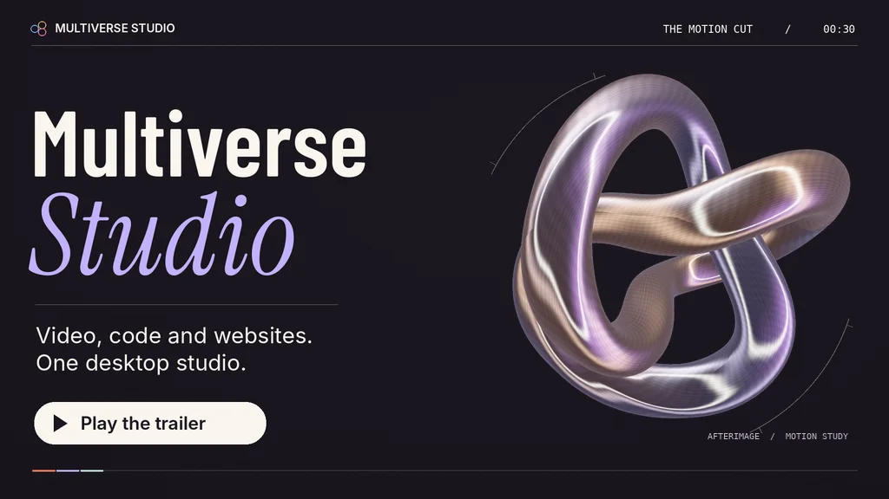
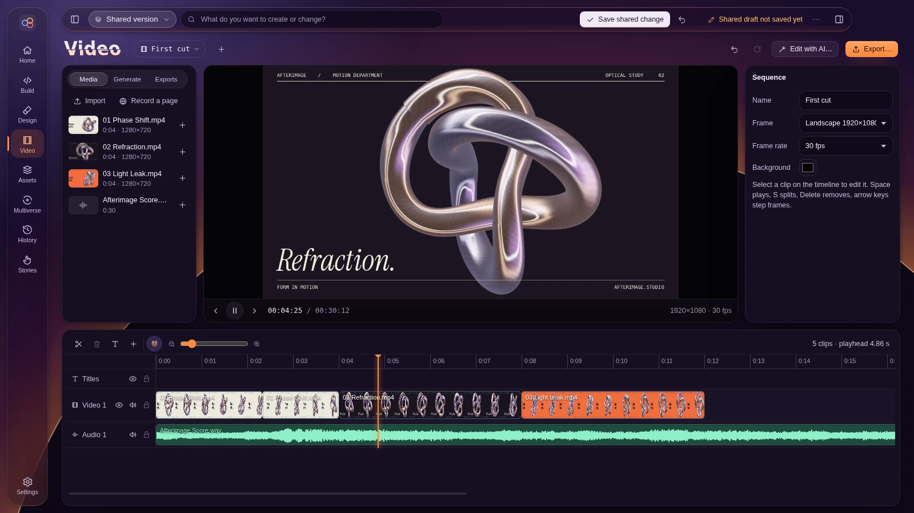
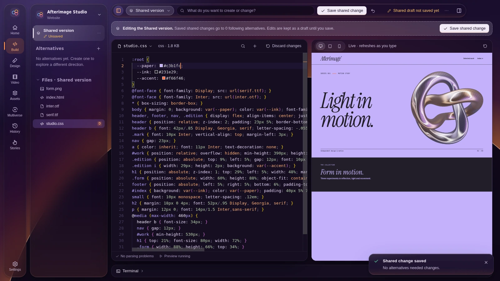
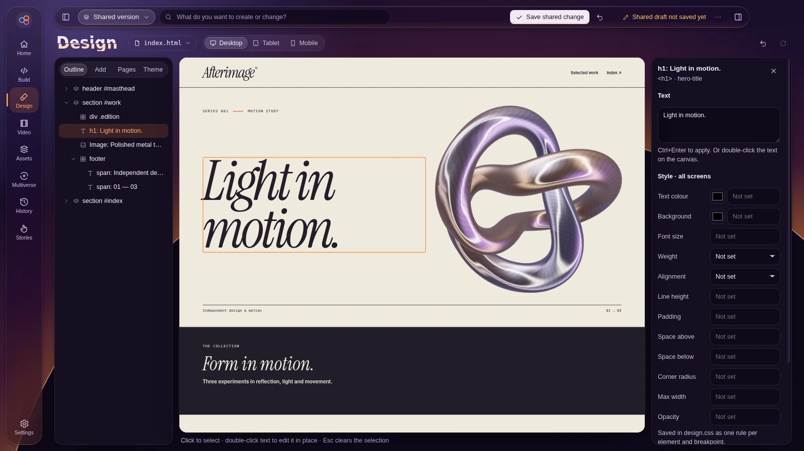

# Multiverse Studio

Edit **video, code, and websites** in one local-first desktop studio. Cut a launch film, design the page it lives on, and open the source beside a live preview. Keep multiple versions of the project and take your favorite parts from each.

<a href="https://cdn.jsdelivr.net/gh/ll2Rawll/Multiverse-Studio@motion-cut/docs/media/multiverse-studio.mp4"><picture><source media="(prefers-reduced-motion: reduce)" srcset="docs/media/trailer-poster.webp"></picture></a>

**[Watch the 30-second motion cut](https://cdn.jsdelivr.net/gh/ll2Rawll/Multiverse-Studio@motion-cut/docs/media/multiverse-studio.mp4)** · [Download the MP4](https://raw.githubusercontent.com/ll2Rawll/Multiverse-Studio/motion-cut/docs/media/multiverse-studio.mp4) · [Illustrated storyboard (PDF)](docs/media/trailer-storyboard.pdf) · [Get the source ZIP](https://github.com/ll2Rawll/Multiverse-Studio/archive/refs/tags/motion-cut.zip)

## Inside the studio

| Video editor | Code editor | Website designer |
| :--- | :--- | :--- |
| [](docs/media/video.webp) | [](docs/media/code.webp) | [](docs/media/website.webp) |
| Trim and split clips, layer titles and audio, then export an MP4 or WebM with FFmpeg. | Edit real project files in Monaco. See CSS changes in the adjacent preview, or run an app with its own dev server. | Click an element to edit it on the page. Check the mobile layout and keep the resulting HTML and CSS. |

The trailer follows **Afterimage** from a timeline split to a responsive headline and a live CSS color change. The editor recordings and all three design previews come from the running desktop app. The closing shot features the same sculpture on a separately lit 3D set. [Open a full-size screenshot of the Assistant answering a question about the project.](docs/media/assistant.webp)

## Try it

Install **Node.js 22.12 or later** and npm. For video import and export, put `ffmpeg` and `ffprobe` on your PATH. From the project folder, run

```sh
npm ci
npm run dev
```

Choose **Create manually → Create the sample project** to open *Kiln*. Change a headline in the Shared version, then compare how it looks in the Minimal, Editorial, and Bold layouts. You can also start with a website, app, or video template.

## Explore versions and work with AI

- **Compare alternatives side by side.** Try a different layout or cut, keep independent edits, and combine individual sections, files, or clips. Checkpoints let you revisit an earlier decision.
- **Bring your own model.** Ask the Assistant about the open project, or give a coding task its own working copy. Connect a local server such as Ollama or LM Studio, or configure a hosted provider. Manual editing works offline.
- **Take the work with you.** Export a site as a folder or ZIP, render a video to disk, or connect a publishing destination for a website.

[Studio guide](docs/GUIDE.md) · [Walk through a complete project](docs/DEMO.md) · [Release audit and test results](docs/AUDIT.md) · [MIT license for the software](LICENSE)
